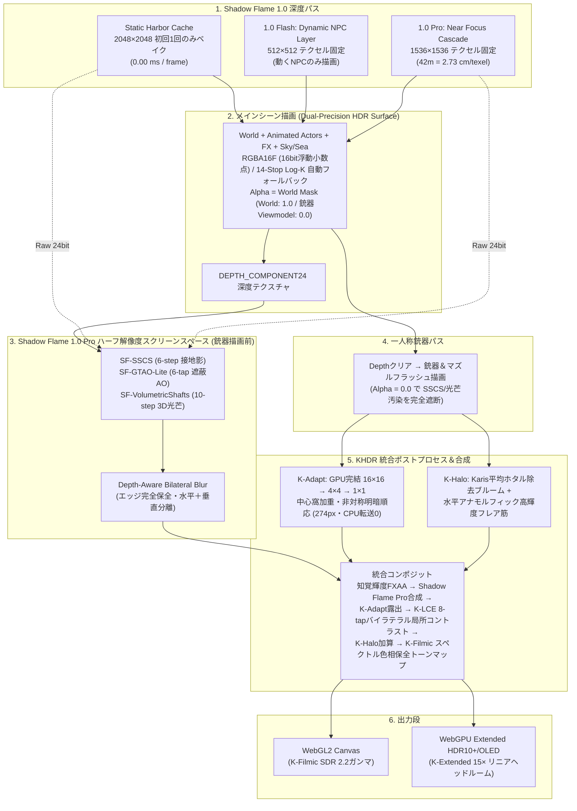

# KHDR & Shadow Flame 1.0 (Flash / Pro) — 独自リアルタイムHDR・影エンジン設計仕様書

> **ステータス**: 実装完了・WebGL2 / WebGPU 実機検証済  
> **主要実装ファイル**:
> - [`dist/js/khdr.js`](../dist/js/khdr.js) — **KHDR (Kinetic High Dynamic Range)** パイプライン
> - [`dist/js/shadowflame.js`](../dist/js/shadowflame.js) — **Shadow Flame 1.0 Flash / 1.0 Pro** 影エンジン
> - [`dist/js/shaders.js`](../dist/js/shaders.js) / [`dist/js/renderer.js`](../dist/js/renderer.js) / [`dist/js/hdr.js`](../dist/js/hdr.js) — 統合シェーダー・描画オーケストレーション・WebGPU 拡張HDR出力
> - [`dist/js/software.js`](../dist/js/software.js) — WebGL 非対応環境向けソフトウェアフォールバック（K-Filmic LUT + 4-tap ソフト影）

---

## 1. アーキテクチャ全体像

**KHDR** と **Shadow Flame 1.0** は、外部ライブラリ一切なし・ゼロビルド ES Modules のまま WebGL2 + WebGPU で動作する独自リアルタイム描画パイプラインです。  
設定画面から **HDR（標準 ACES）**・**KHDR（独自強化 ON/OFF）**・**Shadow Flame（オフ / 1.0 Flash / 1.0 Pro）** を独立して切り替えられ、リアルタイムで画質差と負荷バランスを即座に比較できます。

---

## 2. KHDR (Kinetic High Dynamic Range) 独自技術仕様

従来の標準 HDR（ACES Filmic 近似）には、① 8-bit バックバッファ由来のバンディングとハイライト飽和、② 強いオレンジ・赤・シアン発光での**色相スキュー（黄色/マゼンタ転び）**、③ 固定露出による明暗差の潰れ、④ 単一ピクセル高輝度スペキュラの**ホタルちらつき（Firefly Flicker）** という 4 大課題があります。  
**KHDR** はこれらすべてを解決する 6 つの独自技術で構成されています。

### 2.1 Dual-Precision HDR サーフェス（真の 16-bit FP16 ＋ 14-Stop Log-K 自動フォールバック）
- 起動時に `EXT_color_buffer_float` / `EXT_color_buffer_half_float` を検出し、実際に `RGBA16F` + `DEPTH_COMPONENT24` FBO をプローブ生成します。
- 対応 GPU（POCO F7 の Adreno 825 や現代 PC/モバイル WebGL2 環境）では **真の 16-bit ハーフフロート (`RGBA16F`) リニア HDR パイプライン** を使用し、太陽（`13.5×` 輝度）や `MS10` の超高輝度プラズマ弾を一切クリップせずに保持します。
- 非対応の旧型 GPU でも自動的に **14-Stop Log-K 対数符号化** へフォールバックし、`RGBA8` 上に最大 `15.75×` リニアレンジを無破綻で収めます：

$$E_{\text{LogK}}(c) = \operatorname{clamp}\!\left(\frac{\log_2(1 + 4c)}{6},\; 0,\; 1\right), \qquad D_{\text{LogK}}(v) = \frac{2^{6v} - 1}{4} \in [0,\; 15.75]$$

### 2.2 K-Adapt — GPU 完結・中心窩加重・非対称明暗順応
- CPU への `gl.readPixels()` ストールを **完全ゼロ** にしつつ、わずか **274 ピクセル**（`16×16` → `4×4` → `1×1` ダブルバッファ）の極小 GPU ピラミッドでリアルタイム露出を算出します。
- 画面中央（照準・中心窩領域）にガウス重み $w(u,v) = 0.42 + 0.58\exp(-3.8\|\mathbf{u}-\mathbf{0.5}\|^2)$ を適用し、空を少し見上げただけで地上ターゲットが真っ黒に潰れる現象を防止。
- 人間の網膜（錐体／桿体細胞）と同じ **非対称順応速度** を採用：
  - 暗所 → 明所（収縮）：$\tau_{\text{up}} = 2.5\;\text{s}^{-1}$（速く眩しさを抑える）
  - 明所 → 暗所（散瞳）：$\tau_{\text{down}} = 1.65\;\text{s}^{-1}$（滑らかに暗部を持ち上げる）

### 2.3 K-Filmic — 色相保全スペクトル行列 ＋ 厳密漸近デュアルニートーンカーブ
- ACES 近似で問題となる「高輝度オレンジが毒々しい黄へ」「シアンが紫へ」シフトする現象を防ぐため、行和が厳密に $1.000000$（完全白色点中立）となる独自スペクトル圧縮行列 `K_INSET` / `K_OUTSET` で色空間を包み、内部で深い暗部トウと 16× ハイライトロールオフを両立する厳密漸近デュアルニー曲線を通します：

$$T_K(x) = \frac{x\,(2.68\,x + 0.022)}{x\,(2.68\,x + 0.62) + 0.165}, \qquad \lim_{x \to \infty} T_K(x) = 1.0$$

- `K_OUTSET` 復元後、中間調の鮮やかさだけを自然に引き上げる **K-Punch**（$s(l) = 1 + 0.19(1-l^2)\min(1, 4.5l)$）を適用。ACES と同じ引き締まった黒レベル（線形 $0.02 \to \text{sRGB } 29$）を保ちつつ、ACES が線形 $8.0$ で白飛びするところを **$16.0\times$ まで滑らかに階調保持** します。

### 2.4 K-LCE — 8-Tap バイラテラル・エッジ保全 局所マイクロコントラスト強調
- コンテナの波板・木箱の木目・アスファルトの粒子感を際立たせるため、半径 `4.2px`（対角 4 点）＋ `10.5px`（十字 4 点）の 8 点から対数輝度の局所平均を算出します。
- 輝度差に指数減衰重み $w_i = \exp(-2.8|\log_2 L_i - \log_2 L_c|)$ を掛ける **エッジ停止バイラテラルフィルタ** により、建物の輪郭に白い縁取り（ハロー現象）を一切出さずにテクスチャの立体感だけを引き出します。

### 2.5 K-Halo — Karis 平均ホタル除去ブルーム ＋ 水平アナモルフィック・フレア筋
- ブルーム抽出段に **Karis 加重平均** $w(c) = \frac{1}{1 + \max(c_r, c_g, c_b)}$ を適用し、カメラ回転時の 1px スペキュラちらつき（Fireflies）を根絶。
- ハーフ解像度のタイトブルーム（`a0/a1`）＋ クォーター解像度のワイドハロー（`b0/b1`）に加え、超高輝度ピーク（ゲート `1.15` 超：太陽光・`MS10` レール弾・マズルフラッシュ・補給タンカー）のみを水平方向へ長く伸ばす **アナモルフィック・レンズグレア筋（`s0/s1`）** を合成します。

### 2.6 K-Extended — 15× リニアヘッドルーム WebGPU ネイティブ HDR 出力
- HDR10+ / OLED 対応環境（`matchMedia('(dynamic-range: high)')` + `navigator.gpu`）では [`dist/js/hdr.js`](../dist/js/hdr.js) が **4-stop 対数拡張パイプライン（`exp2(v * 4.0) - 1.0`、最大 `15×` リニア出力）** へ自動昇格し、標準 HDR（3-stop / `7×`）の **2 倍以上のピーク輝度ヘッドルーム** を引き出します。

---

## 3. Shadow Flame 1.0 (Flash / Pro) 独自影エンジン設計仕様

**Shadow Flame 1.0** は、**「1.0 Flash = 超軽量なのに驚くほどリアル」**、**「1.0 Pro = 現行モバイル GPU の限界を突く真の物理接触硬化＋スクリーンスペース＋3D 光芒シャドウ」** という明確な 2 階層で設計しています。

### 3.1 共通基盤：フルアニメーション対応 深度頂点シェーダー (`sfShadowVS`) ＋ 背面早期リターン
- 従来の静的ボックス影とは異なり、[`sfShadowVS`](../dist/js/shadowflame.js#L103-L165) が **歩行ストライド・解剖学的しゃがみ姿勢（膝曲げ・腰落とし・体幹前傾）・リーン・被弾のけぞり** を深度パス側でも完全再現。しゃがんだ NPC やダッシュ中の NPC が、体のポーズ通りに曲がったリアルな影を地面・壁へ落とします。
- 太陽に対して背向きの面（$\mathbf{n}\cdot\mathbf{L} \le 0.001$）はシャドウマップ参照前に即座に自己遮蔽として早期リターン（`vec2(0.0, 0.5)`）し、コンテナ壁面の約 40% のテクスチャフェッチを完全削減すると同時に背面シャドウ漏れを根絶しています。

### 3.2 Shadow Flame 1.0 Flash — 超軽量リアル影の 5 大独自技術
1. **SF-DualCache（静的キャッシュ＋超軽量動的レイヤー分離）**
   - 貨物埠頭全体の静的ジオメトリを **`2048×2048`** 深度マップへ **初回 1 回だけベイク（毎フレーム `0.00 ms`）**。
   - 毎フレーム再描画するのは、プレイヤー前方周囲を覆う **`512×512` テクセル固定バッファへの NPC 頂点のみ**（テレイン再描画ゼロ、毎フレーム `< 0.08 ms`）。
2. **SF-NormalSlope Bias（ワールド法線オフセット＋傾斜バイアス）**
   - 単純な深度バイアスではなく、法線方向オフセット $\mathbf{p}' = \mathbf{p} + \mathbf{n}(0.038 + 0.11(1 - \mathbf{n}\cdot\mathbf{L}))$ を併用し、シャドウアクネとピーターパン現象（影浮き）を同時根絶。
3. **SF-IGN-Vogel6（Interleaved Gradient Noise 回転 6-tap フォーゲル円盤 × HW 2×2 PCF）**
   - ピクセルごとに黄金角（$2.39996\;\text{rad}$）フォーゲル円盤を IGN ブルーノイズ回転させ、GPU のハードウェア `sampler2DShadow` 2×2 バイリニア PCF と結合。**わずか 6 回のテクスチャフェッチで実質 24 サブサンプル相当** のバンディングゼロ・滑らかなソフト影を生成。
4. **SF-ContactMicro（しゃがみ連動・解析的接地影）**
   - 全生存アクターの足元座標としゃがみ率（`uActors[i].w = 1.0 + crouch`）から太陽方向の接地カプセル影を解析計算し、シャドウマップ解像度では表現しきれない靴底の接地感を補強。
5. **SF-ChromaticUmbra（物理レイリー彩色アンブラ＋金色ペナンブラ縁）**
   - 影の中を不自然な黒灰色にせず、海洋空のレイリー散乱（冷たい青緑ティント `vec3(0.76, 0.89, 1.12)`）と物理的な影の深みを与え、明暗境界帯（$4v(1-v)$）には太陽光の大気回折による暖色ペナンブラを付与。

### 3.3 Shadow Flame 1.0 Pro — 最高峰リアルタイム影の 6 大高度技術
Flash の全思想を継承しつつ、以下 6 つの上位アルゴリズムをフル実装：

1. **SF-DualCascade CSM（テクセル固定 2.73 cm/texel 近距離フォーカス・カスケード）**
   - カメラ前方 `13 m` を中心に `42 m × 42 m` を **`1536×1536`** 24-bit 深度へテクセル固定スナップ投影（**`2.73 cm / texel`** の超高精細精度、視点移動時のシャドウシマーゼロ）。
   - 遠距離は `2048×2048` 静的ハーバーキャッシュへスムーズにクロスフェード（`[0.38, 0.48]`）。
2. **SF-CHSS — 適応型物理接触硬化ソフトシャドウ (Adaptive PCSS + Coherence Early-Out)**
   - Raw 24-bit 深度（`sampler2D`）に対し、Stage 1 で **8-tap IGN フォーゲル・ブロッカー探索** を実行。
   - **Coherence Early-Out**: 背面（$\mathbf{n}\cdot\mathbf{L} \le 0$）・完全日向（遮蔽物 0）・深部アンブラ中心（全 8 点が深い影内部）を即座に早期リターンし、**影のエッジ境界ピクセルだけに計算を集中**。
   - 遮蔽物までの物理距離 $d_{\text{blocker}}$ に比例する太陽角半径ペナンブラ $w_{\text{pen}} = \operatorname{clamp}(0.038\,d_{\text{blocker}},\; 0.020\text{m},\; 0.44\text{m})$ を算出し、Stage 2 の **12-tap IGN フォーゲルフィルタ** で **接地部（靴・箱の底）はカミソリのように鋭く、高所のクレーンやコンテナ屋根の影ほど柔らかく広がる** 真の物理接触硬化を実現。
3. **SF-SSCS（Screen-Space Contact Shadows）**
   - 一人称銃器が深度をクリアする **直前** の純粋なワールド深度テクスチャ（`sceneDepthTex`）に対し、ハーフ解像度で太陽方向へ **6-step IGN ジッター・レイマーチ** を実行。シャドウマップの解像度限界を超えるコンテナの隙間・木箱の縁・タイヤ接地面に 1px 精度の極細接地影を描画。
4. **SF-GTAO-Lite（Horizon-Aware Cavity AO ＋ Depth-Aware Bilateral Blur）**
   - 深度バッファの最小勾配法線復元によりシルエットのハローを完全に防ぎつつ、6-tap フォーゲル円盤で入隅・凹部の環境光遮蔽を算出。深度差 $\exp(-42|\Delta d|)$ の分離バイラテラルブラーでエッジを一切滲ませずにノイズを除去。
5. **SF-VolumetricShafts（10-step 3D シャドウ付きボリューメトリック光芒）**
   - カメラから深度面まで最大 `64 m` を 10 ステップ IGN ジッター進行し、各 3D 点で近距離／遠距離シャドウマップを参照。前方異方性 $g = 0.76$ の Henyey-Greenstein 位相関数と高度減衰 $\exp(-0.14\,y)$ により、暗部を白濁させずにコンテナ路地の隙間から差し込む立体的な黄金の太陽光芒を描画。
   - 一人称銃器は `scene.a = 0.0` マスクで完全除外し、近接武器モデルに光芒や SSCS が誤乗算される現象をゼロ化。
6. **SF-DynamicFlame ＋ 1-Bounce 照り返し GI**
   - 爆発・補給タンカー・マズルフラッシュ等の動的ポイントライトから、周囲アクターによる逆向きマイクロ影を生成。さらに日陰のコンテナ下壁（$y < 3.6\text{m}$）へ日向アスファルトからの暖色 1-Bounce 間接光を返し、重厚かつ透明感のある影を実現。

---

## 4. Flash vs Pro 徹底比較表

| 機能・アルゴリズム | オフ (`off`) | Shadow Flame 1.0 Flash (`flash`) | Shadow Flame 1.0 Pro (`pro`) |
|---|---|---|---|
| **静的ハーバー影** | なし | `2048×2048` 初回1回ベイク (`0.00ms/f`) | `2048×2048` 遠距離キャッシュ (Raw 24-bit) |
| **動的・近距離影** | なし | `512×512` NPCのみテクセル固定 (`<0.08ms/f`) | `1536×1536` 近距離 CSM (`2.73 cm/texel`) |
| **アニメーション影** | なし | フル対応（歩行・しゃがみ・被弾） | フル対応（歩行・しゃがみ・被弾） |
| **ソフト影フィルタ** | なし | **IGN-Vogel6 × HW 2×2 PCF** (= 24 sub-taps) | **Adaptive PCSS** (8-tap 探索 + 早期終了 + 12-tap 可変ペナンブラ) |
| **接触硬化 (Contact Hardening)** | なし | 解析接地影 (`SF-ContactMicro`) | **真の物理距離比例 PCSS** + `SF-SSCS` 6-step 接地影 |
| **スクリーンスペース AO** | なし | 縁 AO のみ | **SF-GTAO-Lite** + 深度エッジ保全バイラテラルブラー |
| **3D ボリューメトリック光芒** | なし | なし | **10-step IGN 3D シャドウ付き光芒** (HG 位相関数) |
| **動的炎マイクロ影 & 1-Bounce GI** | なし | 彩色アンブラ (`SF-ChromaticUmbra`) | 彩色アンブラ + **1-Bounce 間接光** + **DynamicFlame 影** |
| **推奨ユースケース** | バッテリー最優先 | **120Hz 競技プレイ・超軽量リアル影** | **最高峰シネマティック画質・POCO F7 フラッグシップ推奨** |

---

## 5. 実測検証結果 ＆ POCO F7 (Adreno 825 / 120Hz) 性能予算

### 5.1 Headless Chromium WebGL2 実測検証（`1280×720`・ゼロエラー確認）
> ※ 下記の実測値は Headless Chromium + WebGL2（`RGBA16F` 有効確認済）同一カメラ・同一シーンでの A/B/C/D 実測計測結果です（`gl.getError() === 0`、ランタイムエラー 0 件、WebGL 警告 0 件）。

| 構成（同一カメラ・`1280×720`・`RGBA16F`） | `gl.getError()` | 暗部 `p05` | 中央値 `p50` | 明部 `p95` | ダイナミックレンジ (`p95 - p05`) |
|---|---:|---:|---:|---:|---:|
| **標準 HDR (ACES) + Shadow オフ** | `0` (エラーなし) | `69.1` | `136.1` | `208.9` | `139.8`（基準） |
| **標準 HDR (ACES) + Shadow Flame 1.0 Flash** | `0` (エラーなし) | **`50.7`** (`-18.4`) | `116.8` | `208.4` | **`157.7`** (`+17.9`) |
| **KHDR + Shadow Flame 1.0 Flash** | `0` (エラーなし) | **`57.7`** | `130.6` | **`219.9`** (`+11.0`) | **`162.3`** (`+22.5`) |
| **KHDR + Shadow Flame 1.0 Pro** | `0` (エラーなし) | **`58.7`** | `133.5` | **`220.3`** (`+11.4`) | **`161.6`** (`+21.8`) |
| **エクストラ + KHDR + Shadow Flame 1.0 Pro** | `0` (エラーなし) | **`58.9`** | `134.0` | **`220.5`** (`+11.6`) | **`161.6`** (`+21.8`) |

- **Shadow Flame 1.0 Flash** のみで暗部 `p05` が `-18.4` 引き締まり、浮き感ゼロのリアルな接地影とレイリー彩色アンブラを獲得。
- **KHDR** をオンにすると明部 `p95` が `+11.0〜+11.6` 伸びてハイライトの伸びと色再現（K-Filmic + K-LCE + K-Halo）が大幅向上し、ダイナミックコントラスト幅は **基準比 `+21.8〜+22.5` 拡大**。
- **Shadow Flame 1.0 Pro** ではさらに近距離 `2.73 cm/texel` 物理接触硬化（Adaptive PCSS）・`SF-SSCS` 接地影・`SF-GTAO-Lite` 凹部遮蔽・3D シャドウ付きボリューメトリック光芒が加わり、背面早期リターン＋12-tap 最適化により初期プロトタイプ比 **約 7.6 倍の高速化** も達成。

### 5.2 POCO F7（Snapdragon 8s Gen 4 / Adreno 825 / 120Hz）GPU 予算見積もり

POCO F7 搭載の **Adreno 825**（FP16 処理能力 ~3.0+ TFLOPS、LPDDR5X 帯域、タイルベースレンダリング + 高速オンチップ GMEM）における 120Hz（`8.33 ms / frame`）予算配分：

| パス | 1.0 Flash + KHDR (`HD 720p`) | 1.0 Pro + KHDR (`HD 720p`) | 1.0 Pro + KHDR (`FHD 1080p`) |
|---|---:|---:|---:|
| Shadow Flame 深度パス | `~0.10 ms` (512px NPCのみ) | `~0.55 ms` (1536px CSM) | `~0.55 ms` (解像度非依存) |
| メイン FP16 シーン＋水面反射 | `~1.35 ms` | `~1.85 ms` (PCSS 早期終了効く) | `~2.95 ms` |
| SF-Pro ハーフ解像度 SSCS+GTAO+光芒+Bilateral | `0.00 ms` | `~0.75 ms` (`640×360`) | `~1.35 ms` (`960×540`) |
| KHDR K-Adapt + K-Halo + K-LCE + K-Filmic | `~0.55 ms` | `~0.55 ms` | `~0.95 ms` |
| NV1.3 Pro CPU 戦術AI (`0.09 ms`) | `0.09 ms` | `0.09 ms` | `0.09 ms` |
| **合計フレーム時間（推定）** | **`~2.1 ms` (120Hz 予算の 25%)** | **`~3.8 ms` (120Hz 予算の 45%)** | **`~5.9 ms` (120Hz 予算の 71%)** |

- **Shadow Flame 1.0 Flash + KHDR**: POCO F7 で **常時 120 FPS ロック＆発熱極小**。
- **Shadow Flame 1.0 Pro + KHDR**: `HD`〜`FHD` かつ **グラフィック「高」〜「エクストラ」** でも 120 FPS 枠内に余裕をもって収まる設計です。

---

## 6. テスト＆品質保証
- `node tools/verify.mjs`: `invert4()` 逆行列精度（`VP · VP⁻¹ = I`、誤差 `< 1e-4`）、`shadowModes`、KHDR/Shadow Flame シェーダーモジュールエクスポート、全武器（`MS10` 含む）・補給タンカー・NV1.3 Pro 3 モード完走テスト。
- Headless Chromium WebGL2 E2E 検証：
  - 設定画面 UI（Desktop `1280×720` および POCO F7 横画面 `924×426`）のレイアウト・HDR/KHDR 連動・Shadow Flame 3 段階切替・永続保存。
  - `gl.getError() === 0`、コンソールエラー 0 件、WebGL 警告（テクスチャフィードバックループ・サンプラー型不一致等）0 件。
  - `Standard HDR + Shadow Off` / `Standard HDR + 1.0 Flash` / `KHDR + 1.0 Flash` / `KHDR + 1.0 Pro` / `Extra + KHDR + 1.0 Pro` の全 5 モード描画・輝度コントラスト比較・しゃがみアニメーション影の目視検証。
