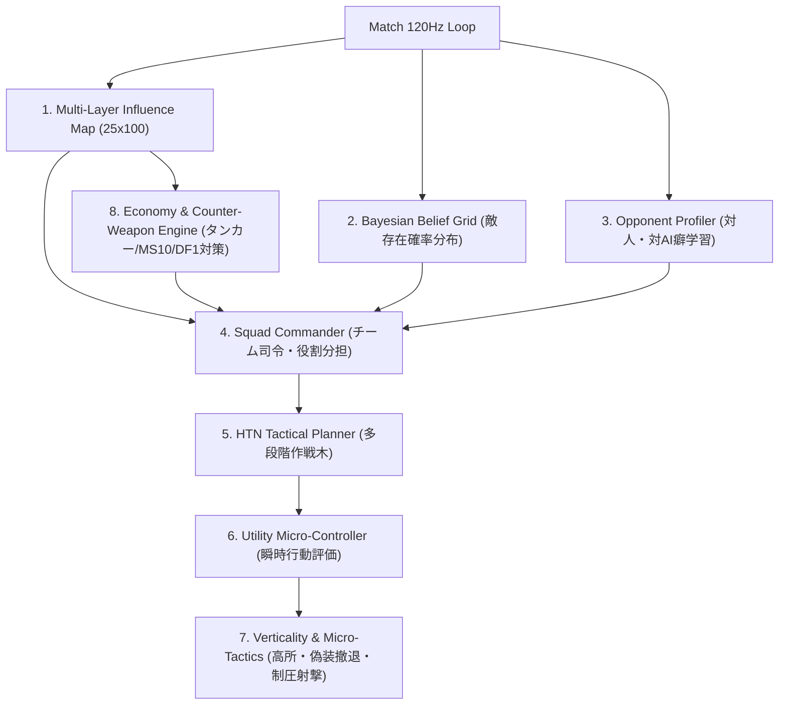

# NPCエンジン「NV1.3」本気設計計画書（Master Architecture Plan）

**対象プロジェクト**: `Result — Harbor Range`（50 × 200 m 貨物埠頭 / 120Hz 固定ステップ / Zero-Build ES Modules）
**系譜**: `NV1.0`（基本経路探索） → `NV1.1`（姿勢制御・直感・学習） → `NV1.2`（生存重視・遮蔽交戦・補給制御・脅威回避） → **`NV1.3`（戦術司令・空間推論・対戦相手モデリング・多層計画AI）**

---

## 1. エグゼクティブ・サマリー：NV1.2からNV1.3への跳躍

`NV1.2` は「無謀に突撃してすぐ死ぬNPC」を根本から脱却し、**個体レベルでの生存本能・ハードカバー離脱・ピーク撃ち（Jiggle-Peek）・武器距離管理・被弾/飛来弾回避・補給タンカー確保・簡易フォーカスファイア**を実現した。実際に 3v3 AI対戦ベンチマークにおいて `NV1.2` は `NV1.1` に **15–6** で圧勝している。

しかし、`NV1.2` にはまだ「**個体最適の集合体**」にとどまる限界がある。
`NV1.3` の本質的な進化は、**「個体の賢い反応」から「分隊としての組織的作戦遂行」および「見えない敵の確率的推論・相手プレイヤーの癖のオンライン学習」**へ昇華させることにある。

| 世代 | コア思想 | 空間認知 | 分隊連携 | 敵予測・適応 | 意思決定構造 |
| :--- | :--- | :--- | :--- | :--- | :--- |
| **NV1.0** | 経路探索と射撃 | 2m 格子 A* (`25×100`) | なし | 視界内のみ | 単純ステート |
| **NV1.1** | 姿勢・簡易学習 | 低遮蔽越え・ピーク | なし | 直線速度外挿 | ルール + 経験重み |
| **NV1.2** | 生存優先・臨機応変 | カバーアンカー + 危険度重みA* | 位置共有・フォーカス指定 | 複数敵追跡 + 簡易待ち伏せ | 優先度付き戦術ステート |
| **NV1.3** | **戦術司令 × 確率推論 × 対人適応** | **多層インフルエンスマップ + 事前計算視線グラフ** | **分隊司令官 (Squad Commander) による連携機動** | **ベイズ確信度グリッド + 対戦相手オンラインモデル** | **HTNプランナー × Utility AI ハイブリッド** |

---

## 2. NV1.3 全体アーキテクチャ（8つのコアサブシステム）

`NV1.3` は `dist/js/nv13.js`（または `dist/js/ai/` モジュール群）として `NV12` の上位互換インターフェース（`attach`, `tick`, `learn`, `onHit`, `metrics`）を維持しつつ、以下の 8 サブシステムで構成する。

---

## 3. 各サブシステムの詳細設計

### 3.1 多層インフルエンスマップ & 事前計算カバー・視線グラフ (`SpatialTactics`)
`dist/js/nv1.js` の既存ナビゲーション格子（`STEP = 2m`, `W = 25`, `H = 100`, 計 **2,500 セル**）と完全一致する `Float32Array(2500)`（1レイヤー僅か **10 KB**）を 5 層保持する。

1. **脅威マップ $T(c)$（Threat / Line-of-Fire）**
   - 確認済み・推定敵位置からの射線通過セルと、直近 8 秒以内の銃撃・被弾・飛来弾（`whiz`）経路に危険度を加算（時定数 $\tau = 6\text{s}$ で減衰）。
   - `MS10` 装備敵の射線は弾速 `648 m/s` ゆえ回避猶予が極小なため、重みを **1.6 倍**に設定。
2. **制圧マップ $C_{\text{ally}}(c)$（Friendly Control）**
   - 味方視界が通っている安全圏。味方同士の**クロスファイア（交差射線）成立角度** $45^\circ \le \theta \le 135^\circ$ を作るセルに高ボーナスを付与。
3. **遮蔽品質マップ $V(c)$（Static Cover Quality — 初期化時1回のみ事前計算）**
   - コンテナ・タンカー・壁際の全カバーアンカー（約 120〜160 箇所）について、8 方向のハードカバー有無、左右のピークエッジ（`peekLeft` / `peekRight`）、およびアンカー間の相互視線ビット行列（$160 \times 160\text{ bit} \approx 3.2\text{ KB}$）を試合開始時にプリベイクする。
   - これにより「敵がセル $A$ にいるとき、視線を完全に切りつつ最短 1 歩で撃ち返せるセル $B$」を **レイキャストゼロ・$O(1)$ ビット演算**で検索可能にする。
4. **チョークポイント & 迂回価値マップ $K(c)$**
   - 埠頭は 50 × 200 m の縦長構造（東：倉庫壁側、中央：コンテナ迷路、西：岸壁・海側）のため、レーン閉塞度を算出。敵が中央レーンを固めているとき、自動的に東側/西側の未監視レーンへ低コスト経路を引く。
5. **戦略目標価値マップ $O(c)$（Tanker & High-Ground）**
   - 3 基の補給タンカー（南 `(10, 62)`、中央 `(-6.5, -5)`、北 `(12, -58)`）のクールダウン残り時間と味方・敵の弾薬枯渇度から価値を動的に変動させる。

---

### 3.2 ベイズ確信度グリッド & 否定的観測による敵位置推論 (`BeliefMap`)
現在の `NV1.2` は最後に見た座標 `lastPos` に頼るため、敵がコンテナ裏を 20m 回り込むと「そこにまだいる」と誤認しやすい。
`NV1.3` では全敵アクターごとに（あるいはチーム統合で）確率分布 $P(c, t)$（$\sum_c P(c, t) = 1$）を保持する。

- **拡散ステップ（Diffusion, 2Hz更新）**:
  敵の最大移動速度（通常 `4.68 m/s` / スプリント `6.75 m/s`）に基づき、通行可能隣接 8 セルへ確率を拡散。さらに敵の直前進行方向ベクトルへ異方性バイアスをかける。
- **否定的観測更新（Negative Observation）**:
  味方（NPC 含む）の視界レイがセル $c$ を通り、そこに敵が**居なかった**場合：
  $$P(c) \leftarrow P(c) \times 0.05$$
  その後全体を正規化する。これにより「東レーンを見たが居ない → 敵は西レーンか中央コンテナ裏へ回り込んだ確率が 82% に跳ね上がる」という**人間の上級者と同じ消去法的推論**が自然に創発する。
- **音響・弾道観測更新（Acoustic & Ballistic Evidence）**:
  - 銃声（`fire`）・被弾方向（`hit`）・飛来弾軌跡（`whiz`）・補給タンカー起動（`tanker`）を観測した瞬間、該当セル周辺の確率分布をガウス尤度で鋭く収束させる。
  - 特に補給タンカーが敵によって起動された場合、視界外であっても「そのタンカー地点に敵が確定存在し、かつ弾薬+100・精製1.5×を得た」ことを正確に把握し、待ち伏せや挟撃に即座へ移行する。

---

### 3.3 分隊司令官（`SquadCommander`）による組織的連携機動
各チーム（`team 0`, `team 1`）に 1 インスタンスの司令官を置き、`0.5s` 間隔で戦局を評価してチーム全体の**作戦（Playbook）**と各個体の**役割（Role）**を割り当てる。

#### 動的役割（4ロール）
| ロール | 主な任務 | 適性条件 |
| :--- | :--- | :--- |
| **Anchor（釘付け・制圧）** | 敵の正面カバーを張り、視線と注意を固定する | HP/シールド高・`D1` / `SRA` |
| **Flanker（側面奇襲）** | 脅威マップ低コスト経路で 60°〜120° の横軸を取りクロスファイア形成 | 高機動・`MS10` / `SW T` |
| **Support / Overwatcher（援護・カバー）** | 味方の退路をカバーし、敵の追撃をカットする | 中遠距離維持・`SW T` / `MS10` |
| **Quartermaster（補給制御）** | 残り5秒以内に再稼働する補給タンカーを先行確保・敵への妨害 | 残弾低下時・最も近い個体 |

#### 組織的プレイブック（3v3 / 1v2 で真価を発揮）
1. **Fire-and-Maneuver（制圧と機動）**:
   Anchor が敵の遮蔽エッジ付近へ牽制射撃（制圧射撃）を行って敵の頭を下げさせ、その間に Flanker が側面コンテナへ前進する。
2. **Synchronized Pincer（同期挟撃）**:
   2 体が別方向から敵を挟む際、先に着いた側が単独で突撃せず **「待機（Hold）」** し、もう 1 体が射線確立地点から 4m 以内に入った瞬間に **同時ピーク（`syncAttackAt`）** を行う。
3. **Bait-and-Trade（誘い込みとカバー交換）**:
   HP が低下した個体が味方 Overwatcher の射線が通るキルゾーンへ意図的に後退し、追撃してきた敵を味方が側面から確実に仕留める（単独死をゼロにする）。
4. **Tanker Area Denial（補給タンカー封鎖）**:
   中央タンカー `(-6.5, -5)` のクールダウンが残り `6s` を切ると、司令官が「争奪フェーズ」を発令。確保役 1 名＋監視役 1 名でタンカー周辺を制圧し、敵に `+100発 / 1.5×精製` を渡さない。

---

### 3.4 対戦相手オンライン・プロファイリング（`OpponentProfiler`）
人間プレイヤー（および敵NPC）の試合中の行動ログから、**わずか 2〜3 交戦（約 20〜40 秒）で相手の戦術傾向を学習し、カウンター戦術を自動選択**する。

- **追跡する特徴量（相手個体ごと）**:
  - `laneBias`: 東 / 中央 / 西レーンの選択偏り（移動平均）
  - `aggression`: 視認後に距離を詰める比率 vs 遠距離維持比率
  - `peekCadence`: 遮蔽から顔を出す周期（秒）と左右どちらの肩でピークしがちか
  - `adsHabit`: `DF1 OUT` の ADS / `ARV1` ロックを狙う頻度・静止時間
  - `tankerGreed`: 補給タンカーへの執着度
- **自動カウンター発動例**:
  - **高アグレッション相手**: 正面撃ち合いを避け、後退しながら味方射線へ引き込む **カウンターアンブッシュ** に切替。
  - **同一レーン偏重相手**: `laneBias > 0.65` を検知したら、該当レーン出口のコンテナ角に **事前照準（Pre-aim）** を置いた迎撃網を張る。
  - **右ピーク癖相手**: 遮蔽物の右エッジへ照準オフセットを先行配置し、初弾反応遅延を 120ms 短縮。

---

### 3.5 HTNプランナー × Utility AI ハイブリッド意思決定
`NV1.2` の巨大な `if / else` 優先度分岐は条件が増えるほど破綻しやすい。`NV1.3` では二層構造に分離する。

1. **上位層：HTN（Hierarchical Task Network）プランナー（計画：2〜5Hz）**
   - 複合タスク（例：`EliminateTarget`, `SecureTanker`, `BreakStalemate`, `SurviveAndReset`）を前提条件付きで複数ステップの行動列（プラン）へ分解する。
   - **例：`SecureAndAmbushTanker`**
     1. 危険度の低い迂回ルートでタンカー視界外 12m まで接近
     2. 周辺クリアリング（ピーク確認）
     3. タンカー取得（+100発・精製1.5×獲得）
     4. 即座に直近ハードカバーへ移動し、音につられて来る敵を 4 秒間迎撃
   - プラン実行中は **ヒステリシス（最低維持時間 + スコア閾値差）** を持たせ、迷い・振動（フラッピング）を完全防止。ただし致命的割り込み（被弾バースト・HP危険・至近距離急襲）では即座にリプランする。

2. **下位層：Utility AI マイクロコントローラ（行動評価：15〜30Hz）**
   - 連続関数（Response Curve：シグモイド / 二次関数）で「今この瞬間の最適微行動」をスコアリング。
   - 離脱効用（Disengage Utility）の例：
     $$U_{\text{disengage}} = \sigma\!\left(\frac{65 - \text{HP}_{\text{eff}}}{18}\right) \cdot \left(1 + 0.35 \cdot N_{\text{aimingAtMe}}\right) \cdot \left(1 + 0.4 \cdot \mathbb{I}[\text{mag}=0]\right)$$
     ここで $\text{HP}_{\text{eff}} = \text{HP} + 1.4 \times \text{Shield}$。シールドが割れた瞬間かつ複数敵に狙われている場合、HP がまだ 70 あっても即座に離脱し「早死に」を極限まで防ぐ。

---

### 3.6 立体機動・マイクロタクティクス（高所・偽装撤退・制圧射撃）
- **高所コンテナ戦術（Verticality）**:
  `yard.js` の低クレート・段差を踏み台にしたジャンプ登攀リンク（Off-Mesh Link）をナビゲーションに定義し、高所からの撃ち下ろし（ヘッドグリッチ優位）を意図的に活用。
- **不規則ジグル・ピーク & しゃがみ撃ち混ぜ（Anti-Predictable Peek）**:
  `NV1.2` の一定周期ピーク（`0.85s` / `1.05s`）は慣れた人間に読まれる。`NV1.3` ではピーク時間を対数正規分布でランダム化し、さらに「肩だけ一瞬見せて敵の初弾（特に `SW T` や `DF1 OUT`）を空撃ちさせる **ショルダーベイト（Shoulder Bait）**」を導入。
- **制圧射撃（Suppressive Fire）**:
  敵がカバー裏に引っ込んだ直後の `0.8s`、弾薬に余裕があれば（特に補給タンカー取得後や `MS10` 装備時）カバー角へ 2〜3 発撃ち込み、敵の再ピークを封じながら味方の前進時間を稼ぐ。
- **偽装撤退（Feigned Retreat）**:
  敵が近距離で追ってきているとき、カバー裏で 180° 反転して待ち構える「リピーク罠（Re-peek Trap）」を一定確率で実行。

---

### 3.7 武器特性・経済・対特殊装備メタエンジン（`MetaCounter`）
`Result` 固有の最新武器・システムへ完全適応する専用ルール群：

1. **対 `MS10` カウンタープロトコル**:
   - `MS10` は弾速 `648 m/s`（最速）・連射比 `130`・ダメージ `9` のため、**開けた場所での横移動（ストレイフ）回避が極めて困難**。
   - 敵の `MS10` を検知した瞬間、AI は「開けた空間での撃ち合いペナルティ」を 2.2 倍に引き上げ、**ハードカバー間の瞬間ピーク交換のみ**で応戦する。また `MS10` のマガジン 24 発（約 4.4 秒で空）の発砲回数をカウントし、リロード `1.55s` の隙を突いて一気に詰める。
2. **自機 `MS10` 運用ドクトリン**:
   - 高弾速を活かし、通常の武器では当たりにくい**中〜遠距離の移動標的・ジャンプ中の標的**へ精密リード射撃を積極実施。フルオートによるリコイル散らばりを抑えるため、遠距離では 3〜4 発のタップバースト制御を行う。
3. **対 `DF1 OUT`（`ARV1` / `P1` / `EVR1`）カウンタープロトコル**:
   - **`ARV1` ロック破り**: `ARV1` の焦点ロックは連続視認約 **`0.42s`**（約 50 フレーム）で成立する（`verify.mjs` 検証仕様）。敵プレイヤーが `DF1 OUT` を装備している場合、AI は**同一射線への連続露出を `0.34s` 未満に自動制限**し、遮蔽物で一瞬視線を切って `ARV1` のロックゲージを強制リセットする。
   - **対 `EVR1` サーマル対策**: サーマルスコープでは薄暗い隙間からでも体熱シルエットが丸見えになるため、低い遮蔽でのしゃがみ待機ではなく**完全に視線が通らないコンテナ背面**を優先選択する。
   - **`P1` オーバーヒート看破**: 敵が強化バーストを連射した後の冷却期間（約 5 秒）を推算し、そのタイミングで押し上げる。
4. **補給タンカー・タイマー管理**:
   - 3 基のタンカーそれぞれの `25s` クールダウンを司令官が内部タイマーで管理。敵が取得した瞬間から `20s` 後に先行展開し、次の `+100発 / 精製1.5×` を確実に奪取する。

---

## 4. 120Hz リアルタイム性能予算 & タイムスライシング設計

`Result` は `fixed = 1 / 120` 秒でシミュレーションを回しつつ、WebGL2 の「エクストラ」描画（HDRブルーム・16タップ影・動的影）とも共存する必要がある。**AI 全体で 1 ティック平均 `< 0.25 ms`、最悪フレームでも `< 0.80 ms`、GC アロケーション実質ゼロ**を厳守する。

| 処理コンポーネント | 更新周期 | 1回あたり予算 | メモリ / 最適化手法 |
| :--- | :--- | :--- | :--- |
| 運動・射撃・回避マイクロ制御 | `60Hz`（2tickに1回） | `0.06 ms` | 既存アクター配列のインプレース更新 |
| 視界・知覚 & 飛来弾検知 | `20Hz`（個体ごとに分散） | `0.08 ms` | 6体を6フレームにラウンドロビン分散 |
| Utility 評価 & ポーズ選択 | `15Hz`（個体分散） | `0.05 ms` | 配列生成なし・事前確保ワークバッファ |
| HTN プランニング & 危険度A* | イベント駆動 / `2Hz` | `0.25 ms` | 1フレーム最大1体のみ再探索許可（予算キュー） |
| 多層インフルエンスマップ拡散 | `4Hz`（4分割タイル更新） | `0.10 ms` | `Float32Array(2500)` 事前確保・GCゼロ |
| ベイズ確信度グリッド更新 | `2Hz`（行分割更新） | `0.12 ms` | 25行ずつ分割処理でスパイク回避 |
| SquadCommander 作戦立案 | `2Hz`（チーム交互） | `0.05 ms` | 事前計算カバービット行列のビット演算のみ |

---

## 5. 定量評価ベンチマーク & 合格基準（KPI）

「強くなった気がする」という主観を排し、`tools/arena-bench.mjs`（ヘッドレス 120Hz 自動対戦ハーネス）で 50 試合のモンテカルロ対戦を回し、以下の数値目標を全項目達成した時点で `NV1.3` をリリース合格とする。

| 評価指標 | NV1.1 (参考) | NV1.2 (現行) | **NV1.3 合格目標** |
| :--- | :---: | :---: | :---: |
| **対 NV1.2 ヘッドトゥヘッド勝率 (3v3, 50戦)** | — | 50% | **≥ 72%**（平均得失点差 **+4.5 以上**） |
| **対 NV1.1 ヘッドトゥヘッド勝率 (3v3, 50戦)** | 50% | ~85% | **≥ 95%** |
| **平均生存時間（Mean Time To Death）** | ~18s | ~29s | **≥ 42s**（早死に率 30% 以上削減） |
| **初撃被弾後の生還率（カバー離脱成功）** | ~14% | ~38% | **≥ 58%** |
| **クロスファイア撃破率（2方向以上からの連携）** | < 5% | ~18% | **≥ 40%** |
| **補給タンカー確保率（対 NV1.2 戦）** | 0% | 50% | **≥ 68%** |
| **対 DF1 OUT 時 ARV1 ロック被許諾率** | ~65% | ~45% | **≤ 20%**（0.34s 未満ピーク制御） |
| **3v3 / 1v2 / 1v1 試合完走時間（停滞なし）** | < 250s | 72–131s | **全モード 60–160s（膠着・スタック 0件）** |
| **120Hz シミュレーション AI CPU 負荷** | ~0.12 ms | ~0.22 ms | **平均 ≤ 0.30 ms / ピーク ≤ 0.85 ms** |

---

## 6. 段階的実装ロードマップ（4フェーズ）

### Phase 1：空間基盤 & プリベイク（土台構築）
- `dist/js/ai/spatial.js`: `25×100` 多層インフルエンスマップ + 初期化時カバーアンカー抽出・相互視線ビット行列の事前計算。
- `tools/arena-bench.mjs`: 異なる AI 世代（`NV1.1` vs `NV1.2` vs `NV1.3`）を高速ヘッドレス対戦させ、勝率・MTTD・クロスファイア率・CPU 負荷を自動計測する検証ツール。

### Phase 2：確率推論 & 個人戦術高度化（個の完成）
- `dist/js/ai/belief.js`: ベイズ確信度グリッド + 否定的観測更新 + 音響/タンカー観測統合。
- `dist/js/ai/utility-htn.js`: HTN プランナーと連続効用関数の導入。
- `dist/js/ai/counter.js`: 対 `MS10` カバー交換・リロード狩り、対 `DF1 OUT` `ARV1` ロック切り（`<0.34s` ピーク）、不規則ショルダーベイト、制圧射撃。

### Phase 3：分隊司令官 & オンライン対戦相手モデル（組織と適応）
- `dist/js/ai/commander.js`: 4ロール動的割当、Fire-and-Maneuver、同期挟撃（`syncAttackAt`）、Bait-and-Trade、タンカー争奪戦術。
- `dist/js/ai/profiler.js`: 相手のレーン偏り・アグレッション・ピーク癖のオンライン学習とカウンター展開。

### Phase 4：難易度プリセット & 人間味チューニング（ゲーム体験の仕上げ）
- 強すぎて不快（エイムボット的・透視的）にならないよう、**「情報は公平（チート視界ゼロ）、戦術だけが一流」**の原則を徹底検証。
- ロビー設定から選べる AI プリセット（`NV1.2 標準` / `NV1.3 戦術` / `NV1.3 マスター`）や、リプレイ・デバッグ用インフルエンスマップ可視化オーバーレイ（開発者キー）を追加して完成。

---

## 7. 設計原則（絶対ルール）

1. **アンチ・チート原則（Fair-Play Perception）**:
   NV1.3 は壁越しにプレイヤー座標を直接覗き見しない。すべての推論は「視界レイ・銃声・被弾方向・飛来弾・タンカー起動イベント」とベイズ確信度グリッドのみに基づく。
2. **膠着（Stalemate）禁止保証**:
   生存重視になりすぎて互いに待ち続けて試合が終わらない事態を防ぐため、`SquadCommander` は **交戦空白時間 > 12 秒** で段階的に偵察・挟撃・タンカー強制争奪プローブを発動し、常にスリリングな展開を保証する。
3. **既存互換性の維持**:
   `Match` との結合インターフェース（`attach`, `tick`, `learn`, `onHit`, `metrics`）をそのまま維持し、`tools/verify.mjs` の全検証項目を無破壊で通過させる。
