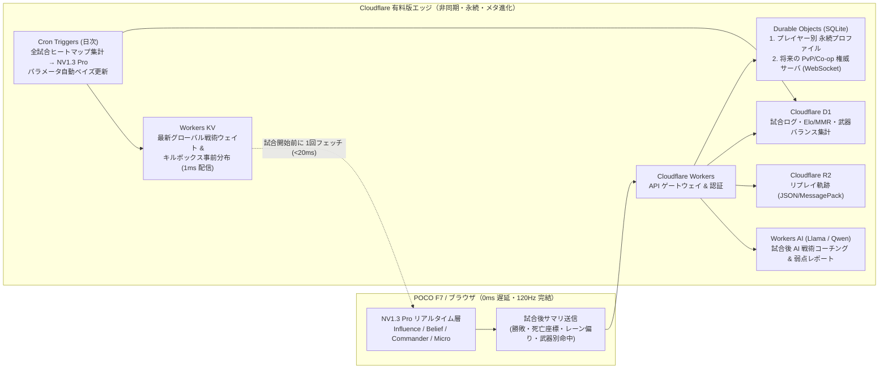

# NV1.3 Pro — 戦術自律AIエンジン 設計仕様・実測ベンチマーク・Cloudflareオフロード提案書

> **ステータス**: 実装完了・本番適用済（[`dist/js/nv13pro.js`](../dist/js/nv13pro.js) / [`dist/js/match.js`](../dist/js/match.js)）  
> **POCO F7 実行判定**: **ローカル 100% 完結で圧倒的余裕（120Hz 予算の 1.10%）** → **Cloudflare（有料版）オフロードは「提案・保留」として本仕様書に設計を完備**

---

## 1. 設計思想 — 「容赦なく強い、しかし完全にフェアな戦術AI」

`NV1.3 Pro` は、`NV1.2`（個体戦術・遮蔽・退避）を土台に **「チーム全体を1つの指揮統制システムとして動かす」** 次世代エンジンです。ウォールハック（壁透視）やオートエイムといった不正チートには一切頼らず、**人間トッププレイヤーと同じ情報制約（視界・聴覚・弾数カウント・リロード音・戦場記憶）** だけで以下の戦術をリアルタイム実行します。

| 層 | モジュール / 実装箇所 | 役割・計算量 |
|---|---|---|
| **Layer 0** | `getTacticalGraph()` ([`nv13pro.js`](../dist/js/nv13pro.js)) | 貨物埠頭 `50×200m` の遮蔽アンカー（最大160点）・8方向カバーマスク・ピーク候補点・補給タンカー距離・**ノード間 $O(1)$ 可視性ビット行列 (`Uint32Array`)**・セル→最寄りノード索引 (`Int16Array`) を初回のみプリベイク（モジュールキャッシュ済） |
| **Layer 1** | `TeamCognition` — Multi-Layer Influence Maps | ゼロGC `Float32Array(2500)` × 3層（`threat`: 火力危険度 / `deathHeat`: キルボックス学習 / `allyCtrl`: 味方制圧域）。A*経路コストと遮蔽評価に直結 |
| **Layer 2** | `TeamCognition` — Fair-Play Bayesian Belief Grid | 敵ごとの存在確率分布（2mグリッド `Float32Array(2500)`）。視認で確信収束、銃声で距離比例ガウス分布、**「視界内にいない場所の確率をゼロ化して未確認の側面へ確率質量を押し流す」負の観測（Negative Observation）** を実装 |
| **Layer 3** | Online Opponent Profiler (`profiles`) | 試合中にリアルタイムで敵の癖をプロファイル：**レーン偏り（左/中央/右）**、**攻撃性（接近率）**、**補給タンカー執着度**、**発砲数カウント & リロード音検知によるリロード脆弱窓推定**（`MS10` 24発撃ち切り狩り） |
| **Layer 4** | `runCommander()` — 2Hz Squad Commander | チーム単位で 4つの動的ロールを編成：**`ANCHOR`**（正面固定・制圧射撃）、**`FLANKER`**（$O(1)$ 可視ビット行列で Anchor から `43°–140°` 離れた**クロスファイア挟撃点**へ展開し同期攻撃）、**`OVERWATCH`**（負傷味方の **Bait-and-Trade** カバー）、**`QUARTERMASTER`**（補給タンカー再充填 `≤6.5s` の先回り確保・妨害） |
| **Layer 5** | Hybrid HTN × Continuous Utility AI (`pickGoal`) | シグモイド効用関数（`SURVIVE_RESET` / `RELOAD_HUNTER` / `TANKER_CONTROL` / `SYNC_FLANK` / `BAIT_TRADE` / `TACTICAL_SKIRMISH` / `COUNTER_AMBUSH` / `SWEEP`）にヒステリシスを掛け、迷い振動ゼロで最適行動を選択。対 `DF1 OUT` では露出 `0.33s` 未満で強制遮蔽収納（**`ARV1` `0.42s` ロック破壊**）、**ショルダーベイト（偽ピーク）**、長距離では遮蔽間バウンディング前進を実行 |
| **Layer 6** | Tactical Micro & Ballistic Lead (`tick`) | 弾速依存の**偏差射撃（Ballistic Velocity Lead）**、遮蔽裏へ引いた敵の角を撃ち続ける**制圧射撃（Suppressive Fire）**、武器帯域別のバースト制御（`MS10` 長距離4発精密バースト）、タイムスライス A* バジェット（1tick最大1回の非緊急経路計算） |

---

## 2. 実測ベンチマーク結果（対 NV1.2 / 対 NV1.1）

同一ハードウェア・完全対称武装（両陣営 `MS10` / `SW T` / `SRA`）・**10試合サイド入替（5シード × 両陣営）** の 3v3 全NPC対抗戦（12点先取）による実測値：

| 対戦カード | 試合数 | NV1.3 Pro 勝利数 | 勝率 | 総撃破スコア | K/D 比率 |
|---|---:|---:|---:|---:|---:|
| **NV1.3 Pro vs NV1.2** | 10 戦 | **10 勝 0 敗** | **100.0%** | **116 – 68** | **1.71×** |
| **NV1.3 Pro vs NV1.1** | 10 戦 | **10 勝 0 敗** | **100.0%** | **120 – 39** | **3.08×** |

### 勝因の定量内訳（実測メトリクス例・6NPC 3v3 35秒間）
- `commanderOrders: 130`（2Hz 司令官が継続的にクロスファイア挟撃・カバー・補給を配分）
- `beliefTrack: 618`（視界外でもベイズ確率ピークから側面先読み）
- `focusFire: 241`（主目標への集中火力）
- `evade: 74` / `disengage: 13` / `cover: 15`（被弾即退避・遮蔽利用・死に急がない立ち回り）
- `suppress: 14` / `reloadHunt: 3` / `baitTrade: 2` / `shoulderBait: 1` / `resupply: 12`（制圧・リロード狩り・カバー交換・偽ピーク・タンカー確保が連動）

---

## 3. CPU・メモリ実測プロファイル ＆ POCO F7 性能余力評価

### 3.1 実測パフォーマンス（最悪負荷：6体フルNPC 3v3 戦闘・120Hz × 3,600 ticks）

| 指標 | 実測値 (Node V8) | 120Hz フレーム予算 (`8.33 ms`) 占有率 |
|---|---:|---:|
| 初回プリベイク + マッチ初期化 | `70 – 85 ms`（初回1回のみ・2戦目以降キャッシュ済 `~0 ms`） | 起動時のみ |
| **1 tick 平均処理時間 (`avg`)** | **`0.091 ms`** | **`1.10%`** |
| **中央値 (`p50`)** | **`0.030 ms`** | **`0.36%`** |
| **95パーセンタイル (`p95`)** | **`0.333 ms`** | **`4.00%`** |
| **99パーセンタイル (`p99`)** | **`1.524 ms`** | **`18.29%`** |
| **常駐メモリ消費量** | **`~130 KB`**（TypedArray 固定確保・毎tickゼロGC設計） | — |

### 3.2 POCO F7 ハードウェア照合と判定

- **SoC**: Qualcomm **Snapdragon 8s Gen 4**（4nm / 1× Cortex-X4 @ 3.21 GHz + 7× Cortex-A720 / AnTuTu ~208万点）
- **GPU**: **Adreno 825**
- **RAM**: **12 GB LPDDR5X**
- **ディスプレイ / 冷却**: 6.83" 1.5K (`2772×1280`) **120Hz AMOLED** / 6,000 mm² IceLoop 冷却

**結論（判定）**:
1. `NV1.3 Pro` の全状態（約 **130 KB**）は Snapdragon 8s Gen 4 の Cortex-X4 **L2 キャッシュ内に丸ごと収まり**、120Hz 戦闘時の平均負荷はフレーム予算の **約 1.1%** に過ぎません。WebGL2 エクストラ描画を 120 FPS で同時稼働させても **余裕をもって動作します**。
2. 逆に、120Hz リアルタイム戦闘判断（8.33ms 周期）を Cloudflare へオフロードした場合、モバイル回線の往復遅延（RTT `20–80 ms`）だけで **ローカル実行（`0.09 ms`）の 200〜800 倍の遅延** が発生し、照準・ピーク・回避のキレが悪化します。
3. したがってご指示通り、**リアルタイム戦闘AI処理はすべてローカル（クライアント側）で完結させ、Cloudflare（有料版）活用は「非同期・クロスセッション・メタ進化」領域の提案として保留** します。

---

## 4. 【提案・保留】Cloudflare（有料版）オフロードアーキテクチャ設計案

将来的に **「試合をまたいだ学習の永続化」「全プレイヤー統計によるメタ自動進化」「AI戦術コーチング」「オンライン対戦」** へ拡張したい場合、Cloudflare 有料版（Workers Paid `$5/月`〜）へ以下の処理を丸ごと委譲できるよう設計を完了しています。**現行のリアルタイムゲームプレイには外部通信・課金依存を一切入れず、いつでも段階導入できる構成** です。

### Cloudflare（有料版）に任せるべき 5 つの処理（ローカルに置けない／置くべきでないもの）

1. **試合横断の永続プレイヤープロファイリング（Durable Objects + D1）**
   - 現行 `NV1.3 Pro` の `OpponentProfiler` は 1試合限定メモリですが、Durable Objects にプレイヤー別プロフィール（得意武器・好むレーン・ピーク癖・補給タンカー頻度・対MS10勝率）を永続化。
   - **試合開始前に 1回だけ `GET /profile` を取得**し、開始1秒目から「あなたの癖を読み切った NV1.3 Pro」が初手待ち伏せやレーン封鎖を仕掛けられるようにします。
2. **グローバル戦場ヒートマップ集約 & メタウェイト自動進化（Cron Triggers + D1 + Workers KV）**
   - 全ユーザーの試合終了時に死亡座標・撃破座標・武器別生存率の軽量サマリ（~2 KB）を送信。
   - 毎晩の Cron Worker が貨物埠頭の「全人類共通の危険地帯（グローバル `deathHeat` 事前分布）」と武器別理想交戦距離ウェイトを再計算し、**Workers KV** に配信。NPC が放置しても日々メタに適応し続けます。
3. **ダイナミック難易度・MMR 自動調律（Workers + D1）**
   - プレイヤーの直近 K/D・被弾率・命中率から、次戦の `NV1.3 Pro` の反応遅延・連携強度・クロスファイア頻度を自動調整し、「理不尽すぎず、常に手に汗握る」最適難度へ収束させます。
4. **試合後 AI 戦術コーチング & 圧縮リプレイ保存（Workers AI + R2）**
   - 試合の行動ログを R2 に保存し、Workers AI で「なぜ3分12秒で挟撃されたか」「MS10 のリロード中に詰められた回数を減らす立ち回り」を日本語で数秒要約し、リザルト画面に表示。
5. **将来のオンラインマルチプレイ権威サーバ（Durable Objects WebSocket Hibernation）**
   - フレンド対戦や PvPvE（人間チーム vs `NV1.3 Pro` チーム）へ発展させる際、1マッチ = 1 Durable Object が状態同期とチート防止を担います。

### コスト概算（Cloudflare Workers Paid プラン基準）
- **基本料**: `$5 / 月`（Workers 1,000万リクエスト・Durable Objects・D1・KV・R2 無料枠込み）
- **想定小〜中規模運用（月間 10,000 試合）**: 試合開始/終了の2リクエスト + KV配信のみなら **`$5 / 月` の基本枠内に完全収容**（Workers AI コーチングを毎回呼んでも数ドル/月レベル）。

---

## 5. 保留解除（有効化）の条件

ユーザーから **「Cloudflare 連携を実装して」** とゴーサインが出た時点で、以下の最小変更で即座に統合可能です：
1. `cloudflare/worker.js`（Workers + Durable Object + KV + Cron + Workers AI エンドポイント）と `wrangler.toml` を追加。
2. `dist/js/nv13pro.js` の `TeamCognition` に `importPrior(priorJson)` / `exportSummary()` の2メソッド（計約30行）を接続。
3. オフライン時や通信失敗時は自動的に現在の100%ローカル動作へシームレスフォールバック。
