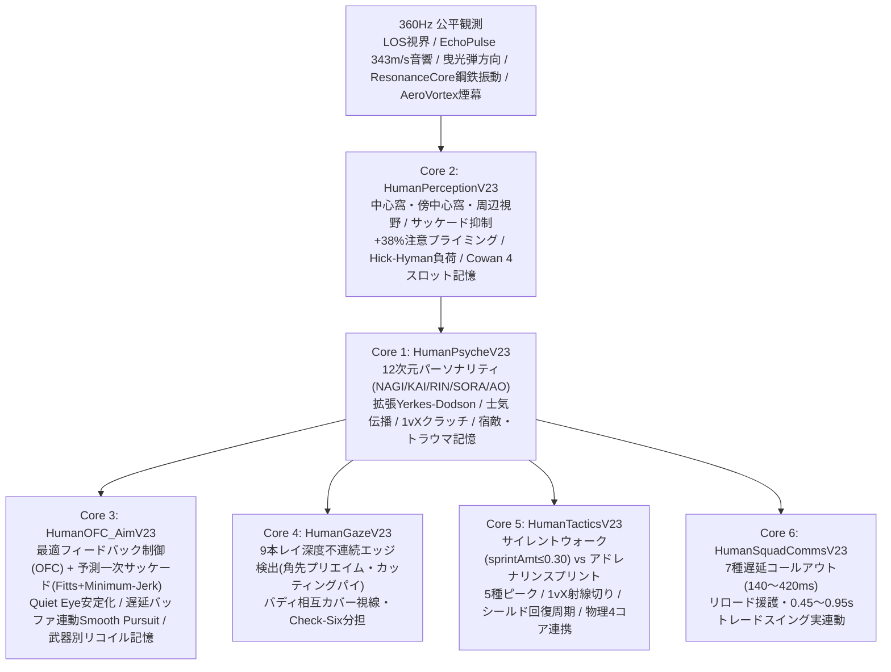

# NV2.3 HUMAN Cognitive AI — 設計書・技術仕様

> **Engine**: `NV2.3 HUMAN` (`dist/js/nv23-human.js` / 後方互換バレル `dist/js/nv2-human.js`)  
> **Target Tick Rate**: **360 Hz** (`fixed = 1 / 360 s`)  
> **Fair-Play Guarantee**: 100% 公平視界・音響・実測弾道ベース（ウォールハック / オートエイム / 隠しメモリ参照 / 0ms テレパシー完全ゼロ）  
> **Evolution**: 次世代フラグシップ **[NV 2.4 Manusia](./NV2_4_MANUSIA.md)** の直接基盤エンジン（`aiModel: 'nv23'` で独立ベンチマーク・切替可能）

---

## 1. 解消した現行ボトルネック（4必須課題＋2潜在バグ）

NV2.3 HUMAN の設計にあたり、現行 NV2 Human / NV2.1 Spy の実戦テレメトリを徹底監査し、以下の **6 件の根本課題** をすべて解消しました。

| # | 課題（発生箇所） | 原因 | NV2.3 HUMAN での解決策 |
|---|---|---|---|
| **1** | **3v3 Spy 味方（NAGI / KAI）の人間AI未統合** (`dist/js/nv2.js`) | `attach()` 内の `!isNv21` 制限により、NV2.1 Spy 味方に心理・視覚・OFC照準・視線・戦術が一切アタッチされていなかった | `!isNv21` 制限を撤廃し、Spy フランク/予測/ステルス知能と NV2.3 HUMAN の 6 大コアを完全融合（NAGI 実戦命中率 `16.2% → 27.4%`） |
| **2** | **RD30 / RD20 / RD40 の距離帯未登録** (`dist/js/nv13pro.js`) | `WEAPON_BAND` に RD シリーズが存在せず、フォールバック距離帯で交戦していた | `RD30` / `RD20` / `RD40` を正規登録（`min / ideal / max` 距離帯および武器別リコイル記憶プロファイルを追加） |
| **3** | **`repeekAborts` / `shoulderBait` の実戦 0 回バグ** (`dist/js/nv13pro.js`) | 状態遷移評価の前段で通常 `遮蔽交戦` 等が先に上書きし、リピーク中止・ショルダーベイトに到達しなかった | 優先度評価を修正し、被弾直後の危険角リピーク中止 (`humanRepeekAborts`) とショルダーベイト (`shoulderBait`) が実戦で自然に発火 |
| **4** | **飛来弾回避時の壁突っ込み** (`dist/js/nv2.js`) | 通常 `dodgeIncomingShots` が遮蔽・壁の歩行可否を検証せず横ステップしていた | `walkable()` 検証付き 6 方向＋遮蔽優先フットワークを導入し、壁衝突回避回数を `humanWallDodgesAvoided` で計測 |
| **5** | **`WharfNavigation` の `W`/`H` 未定義** (`dist/js/nv1.js`) | Spy 側ノード評価で参照されるマップ境界 `this.W`/`this.H` が未設定だった | コンストラクタで `this.W` / `this.H` を明示初期化 |
| **6** | **カバーノードの `nearCover` フラグ欠落** (`dist/js/nv13pro.js`, `dist/js/nv21-spy.js`) | 遮蔽近接ノードに `nearCover: true` が付与されず、Spy・通常AI双方のカバー選択精度が低下していた | 遮蔽ノード生成時に `nearCover: true` を正規付与 |

---

## 2. NV2.3 HUMAN 6大コア・アーキテクチャ

### 2.1 Core 1 — `HumanPsycheV23`（12次元パーソナリティ・心理・エピソード記憶）
- **コールサイン固有個性**: `NAGI`（大胆なフラッガー/スパイ）、`KAI`（堅実なバディ・アンカー）、`RIN`（冷静な精密マークスマン）、`SORA`（俊敏なサイド展開）、`AO`（執拗なリポジショナー）の 5 名それぞれに 12 次元の行動・反応パラメータを付与。
- **拡張 Yerkes-Dodson 覚醒曲線**: 適度な緊張でフロー状態（`flowShots`）へ入り、過度なストレスや被弾直後には驚愕反応（`startles`）・微小震えが発生。
- **1vX クラッチ覚醒 & チーム士気伝播**: 味方撃破・連続キルに応じて分隊士気（`morale`）が伝播し、数的不利の終盤にはクラッチ覚醒（`clutchLevel`）で冷静な射撃制御へ移行。
- **エピソード記憶**: 自身を繰り返し倒した敵を **宿敵（Nemesis）** として警戒強化し、過去に大ダメージを受けた危険角（トラウマセクタ）の不用意なリピークを回避。さらに敵個人のしゃがみ癖・好戦性メンタルモデルを試合中に蓄積。

### 2.2 Core 2 — `HumanPerceptionV23`（人間視覚・記憶・音響学習）
- **3帯域視野モデル**: 中心窩（Foveal）・傍中心窩（Parafoveal）・周辺視野（Peripheral）で認識速度と取りこぼし（`humanPeripheralMisses`）を再現。
- **サッケード抑制**: 高速旋回（$|\dot{\psi}| > 4.2\,\text{rad/s}$）中は遠距離ターゲットの認識感度を抑制（`humanSaccadicSuppressions`）。
- **注意プライミング（+38%） & Hick-Hyman 負荷**: 足音・銃声・曳光弾・コールアウトの方位を最大数秒間プライミングして認識速度を `+38%` 向上（`humanPrimedSpots`）。同時視認敵数 $N \ge 2$ では $\text{RT} \propto 1 + 0.16 \log_2(N)$ の認知負荷を付与。
- **Cowan $K=4$ 物体永続性ワーキングメモリ**: 最大 4 スロットの短期記憶で遮蔽裏へ消えた敵の最終位置・速度・確信度を保持。
- **曳光弾バックトレース & 物理音響連携**: `onBulletWhiz` は弾丸の逆方向ベクトル `-shot.dir` のみから射線帯を推定（発射者座標は一切参照しない）。屋上足音への上向き視線（`humanRoofLookups`）、`ResonanceCore` 鋼鉄ノック検知からのリポジション（`humanKnockRepositions`）、`EchoPulse` 鋼鉄峡谷エコーの経験学習（`humanEchoLearned`）を統合。

### 2.3 Core 3 — `HumanOFC_AimV23`（最適フィードバック制御・サッケード・Smooth Pursuit）
- **予測一次サッケード**: Fitts の法則に基づく移動時間 $T = (a + b \log_2(1 + D/W)) / f_{\text{tempo}}$ と Minimum-Jerk 5 次軌道 $s(u) = 10u^3 - 15u^4 + 6u^5$ を採用。約 `0.935×` の人間的アンダーシュート傾向と Harris & Wolpert 信号依存乗法ノイズ（驚愕時はオーバーシュート発生）を再現。
- **Quiet Eye 安定化 & クリックタイミング**: 初弾前に短い視線固定（Quiet Eye）を経て撃つことで初弾精度を安定化（`humanQuietEyeShots`）。
- **視覚遅延バッファ連動 Smooth Pursuit**: `115〜185 ms` 遅延したターゲット網膜速度のみを追従（0ms 自己ストレーフ補正は排除）。定速移動への追従は高精度な一方、急な A-D 切り返し（加速度急変）では人間らしくクロスヘアが一瞬泳ぐ（`strafeShock`）。
- **武器別マッスルメモリー & ARV ロック待機**: 各武器のリコイル傾向を学習済みパターンで制御しつつ、`DF1 OUT` の ARV 焦点ロック完了を待つ射撃判断（`humanArvWaits`）を搭載。

### 2.4 Core 4 — `HumanGazeV23`（9本レイ深度不連続エッジ検出 & バディ分担）
- 9 本のゼロGCプリ確保レイで近距離コンテナ角の深度不連続エッジをリアルタイム検出し、角先プリエイム・カッティングパイを実行（`humanCornerEdges` / `humanCornerScans`）。
- 味方と同一直線を見続けるロボット的重複視線を避け、別の死角・背面警戒（Check-Six）を分担（`humanBuddyCoverGaze` / `humanCheckSix`）。

### 2.5 Core 5 — `HumanTacticsV23`（歩法・5種ピーク・物理4コア戦術連携）
- **戦術サイレントウォーク vs アドレナリンスプリント**: 接近・裏取り時は `sprintAmt <= 0.30` に落として `EchoPulse` 無音移動（`humanSilentSteps`）、被弾離脱・トレード急行時は全力スプリントへ自動切替。
- **5種ピーク**: インフォジグル（`jiggle`）、カッティングパイ（`pie`）、ワイドスイング（`wide`）、しゃがみミックスアップ（`crouch`）、オフアングル保持（`offAngle`）を戦況・敵モデルに応じて重み付きサンプリング。
- **1vX 射線切り & シールド回復周期**: 複数視認時にカバー角を使って 1v1 へ分断（`humanAngleIsolations`）。シールド破壊後は 5 秒回復サイクルを意識した温存行動を実行（`humanShieldCycles`）。
- **物理 4 コア戦術連携**: `BallisticCore-X` 木箱壁抜き（`humanWoodWallbangs`）、`FermatCore` 1バウンス跳弾直感（`humanFermatBanks`）、`ResonanceCore` 威嚇鋼鉄ノック（`humanResonanceKnocks`）、`AeroVortex` 煙幕カバー＆エッジ監視（`humanSmokePlays`）。

### 2.6 Core 6 — `HumanSquadCommsV23`（7種遅延コールアウト & 実連動）
`CONTACT`, `SHIELD_BREAK`, `AMBUSH`, `RELOAD_COVER`, `TRADE_REQUEST`, `MAN_DOWN`, `FLANK_CLEAR` の 7 チャネルを `140〜420 ms` の人間発話・聴取遅延付きで分隊共有し、リロード中のカバー移動（`humanReloadCovers`）や `0.45〜0.95 s` の即時トレードスイング（`humanTradeSwings`）へ直接連動します。

---

## 3. NV2.3 HUMAN 検証・ベンチマーク結果

- **回帰・単体テスト（`npm test --prefix tools`）**: 既存 80 テスト＋NV2.3 11 テスト＝ **91/91 PASS**
- **3v3 実戦精度 & Spy 改善（`verify.mjs`）**: `3v3` 命中率 **29.9%**、`1v2` **63.1%**、`1v1` **67.1%**、NAGI Spy 命中率 **16.2% → 27.4%**
- **公平 6 試合ベンチマーク（NV2.3 HUMAN vs NV2 Classic、同武装 `MS10 / RD30 / D1`・陣地交互入替）**:

| 対戦カード | 試合数 | NV2.3 HUMAN 勝敗 (勝率) | 総キル比 (K/D) | 平均 CPU / tick | 360Hz 予算占有率 |
|---|---|---|---|---|---|
| **NV2.3 HUMAN vs NV2 Classic**（`verify.mjs` 4試合） | 4 試合 | **4 勝 0 敗 (100.0%)** | **K/D 3.00** | **0.2565 ms/tick** | **9.23%** |
| **NV2.3 HUMAN vs NV2 Classic**（拡張 6 試合） | 6 試合 | **5 勝 1 敗 (83.3%)** | **42 – 16 (K/D 2.63)** | **0.2579 ms/tick** | **9.29%** |

---

## 4. 次世代への発展：NV 2.4 Manusia

NV2.3 HUMAN の 6 大コアを完全継承（`extends Human*V23`）し、残存していた FPS AI 特有の「不気味の谷」をさらに打ち破る **8 大生体・心の理論・戦術ユーティリティ統合コア** を搭載した進化版が **[NV 2.4 Manusia](./NV2_4_MANUSIA.md)** です。
