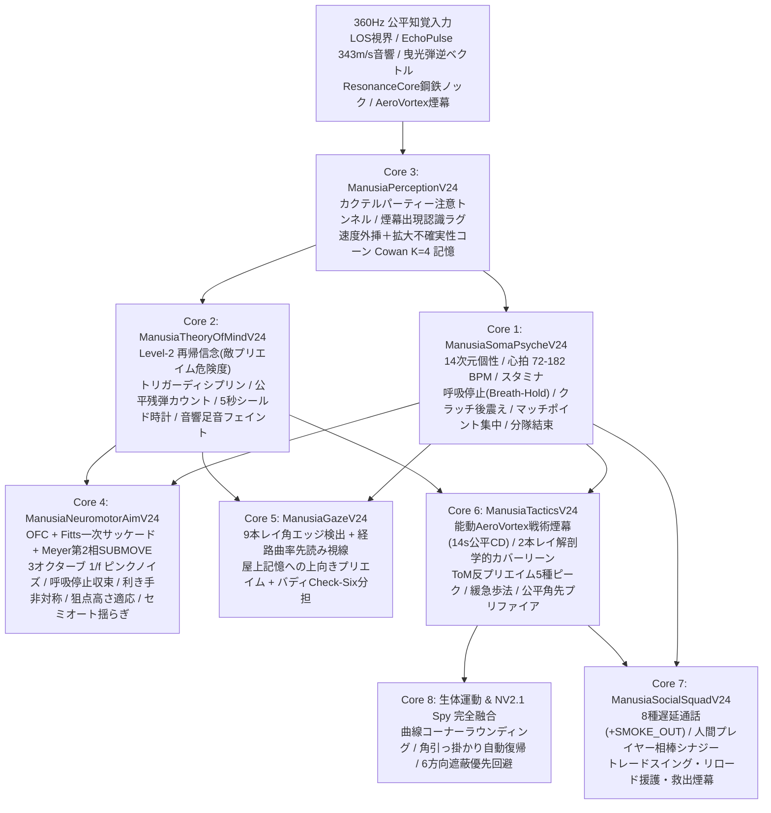

# NV 2.4 Manusia — 設計書・技術仕様

> **Engine**: `NV 2.4 Manusia` (`dist/js/nv24-manusia.js` — `NV2.3 HUMAN` 基盤 `dist/js/nv23-human.js` を継承)  
> **Target Tick Rate**: **360 Hz** (`fixed = 1 / 360 s`, 1 tick 予算 `2.778 ms`)  
> **Fair-Play Guarantee**: **100% 公平視界・音響・実測弾道・公開仕様ベース**（ウォールハック / オートエイム / 敵残弾・HP隠し参照 / 0ms テレパシー完全ゼロ）  
> **Compatibility**: `aiModel: 'human'`（既定＝NV 2.4 Manusia）/ `'nv23'`（NV2.3 HUMAN）/ `'classic'`（NV2 Classic）の 3 世代を完全切替・A/B/C 対戦可能

---

## 1. 開発コンセプト：「不気味の谷」を超える 8 大人間シミュレーション

NV2.3 HUMAN は認知視覚・OFC照準・9本レイ角プリエイム・7種遅延通話により従来の AI と一線を画すリアルさを達成しました。しかし実戦リプレイを深く分析すると、上級 FPS プレイヤーの目にはなお **8 つの微妙な「AI っぽさ（不気味の谷）」** が残っていました。

1. **身体の生理反応の欠如**: どれだけ走っても心拍・スタミナが尽きず、長距離精密射撃前の「息を止める間」やクラッチ生還直後の「手の震え」が存在しない。
2. **高次「心の理論（Level-2 Theory of Mind）」の欠如**: 「敵が自分の直前位置をプリエイムしているはず」「背中を向けた敵を今撃つより一瞬待って確実に仕留める（トリガーディシプリン）」「目撃・聴取した銃声数から敵のリロード間近を読む」「割った敵シールドの 5 秒回復タイマーを頭で数える」「逆側へ強い足音を出して無音で反対へ回る（音響フェイント）」という人間特有の読み合いが欠けていた。
3. **選択的注意トンネルと煙幕ポップアウトの驚き**: 1v1 撃ち合い中のカクテルパーティー的視野狭窄や、未警戒の煙幕端から飛び出した敵への一瞬の認識遅れ、および視界喪失後の「移動速度外挿＋不確実性コーン拡大」が不足していた。
4. **神経運動の微細テクスチャ**: 一次サッケード後の **Meyer 第2相離散補正サブムーブメント**、**3オクターブ 1/f ピンクノイズ揺らぎ**、利き手の左右追従非対称性、敵のしゃがみ癖に応じた狙点高さ調整、セミオート指切り間隔の人間的揺らぎ。
5. **経路曲率を先読みする視線と高低差プリエイム**: 角を曲がる前から次の経路ベクトルへ視線を滑らかに先行させ、屋上の敵を記憶している間は自然に上向きプリエイムを保持する視線制御。
6. **能動的ユーティリティと解剖学的カバーリーン**: 味方や人間プレイヤーを救う **能動 AeroVortex 戦術煙幕展開**、鋼鉄壁に頭を突っ込まず必ず開けた側へ身を乗り出す **ゼロGC 2本レイ解剖学的カバーリーン**、公平な足音・記憶に基づく **角先プリファイア**、および「開けた通路は走り・角際だけ無音で歩く（Sprint the Gap, Walk the Corner）」緩急歩法。
7. **曲線コーナーラウンディング & 人間プレイヤーとの相棒シナジー**: ウェイポイント折れ線のロボット的直角旋回を排した滑らかな曲線コーナー進入、および Team 0 の人間プレイヤーのリロード・瀕死に遅延ボイス＋援護・煙幕で呼応する相棒連携。
8. **3v3 Spy（NAGI / KAI）完全融合**: NV2.1 Spy 戦術知能を NV 2.4 Manusia の生体・心の理論・神経運動・戦術煙幕と一体化。

---

## 2. システム全体アーキテクチャ

---

## 3. NV 2.4 Manusia 8大コア詳細仕様

### 3.1 Core 1 — `ManusiaSomaPsycheV24`（生体生理・心理・14次元パーソナリティ）
`HumanPsycheV23` を継承し、全コールサイン（`NAGI`, `KAI`, `RIN`, `SORA`, `AO`）へ `handedness`（利き手 `±1`）、`triggerPatience`（トリガーディシプリン忍耐度）、`utilityIQ`（戦術煙幕・フェイント知性）、`playerBond`（人間プレイヤー相棒度）を加えた **14次元プロファイル**（`CALLSIGN_PROFILES_V24`）を構築。

- **自律神経モデルによる心拍数（72〜182 BPM）**:
  $$\text{BPM}_{\text{target}} = \text{clamp}\!\left(72 + 44\,\text{exertion} + 36\,\text{adrenaline} + 34\,\text{stress} + 18\,\text{clutch} + 12\,\text{stakes} + \Delta_{\text{HP}} + 16(1-\text{stamina}),\; 72,\; 182\right)$$
  上昇は速く（$k_\uparrow = 1.45\,\text{s}^{-1}$）、鎮静は緩やか（$k_\downarrow = 0.48\,\text{s}^{-1}$）という生理的非対称性を再現。
- **生体スタミナ & 精密呼吸停止（Breath-Hold）**: スプリント・ジャンプでスタミナ消費、歩行・遮蔽待機で回復。長距離（$\ge 18\text{m}$）・低速・Quiet Eye 安定時に自発的呼吸停止を発動（`manusiaBreathHolds`）し、呼吸揺らぎを `0.03 Hz` まで鎮め射撃マイクロ拡散を約 `9%` 収束。
- **クラッチ後アドレナリンダンプ（`postFightShake`）**: 瀕死・複数戦を生き延びてキルを獲得した直後、一拍おいて手元の微振動（`manusiaAdrenalineDumps`）が発生し、時間経過で自然に収束。
- **マッチポイント集中（`matchPointIntensity`） & 分隊結束（`cohesion`）**: 勝利まで残り 2 キル以下で緊張感と集中力が高まり、トレード成功や救出連携で分隊結束が向上。

### 3.2 Core 2 — `ManusiaTheoryOfMindV24`（Level-2 心の理論・読み合い）
**100% 公平情報のみ** を用いて「敵が今どう認識しているか」を内部モデル化します。

| 機能 | 入力（100%公平） | 人間的行動・戦術効果 |
|---|---|---|
| **再帰プリエイム危険度** (`getEnemyPreAimRisk`) | 自分が敵へ露出した最終座標・時間 (`myLastExposedPos`) と自発音座標 (`myLastSoundPos`) | 敵が自分の角を待ち構えている確率を算出し、同じ角の再顔出し回避・ワイドスイング・オフアングル・音響フェイントへ切替 |
| **トリガーディシプリン** (`evaluateTriggerDiscipline`) | 視認中敵の向き（背中・横向き）＋視認時間 | 未警戒で背中を向けた敵に対し、即撃ちせず `0.22〜0.48s` だけクロスヘアを確実に合わせる（`manusiaTriggerDisciplines`） |
| **公平残弾カウンタ** (`onObservedEnemyShot` / `predictEnemyReloadSoon`) | 視認したマズルフラッシュ・到達済み `EchoPulse` 銃声＋公開武器カタログ容量 `PUBLIC_MAG_CAP` | **敵の `actor.mag` / `actor.reload` は一切参照せず**、観測発砲数が公開マガジン容量の `72%` に達すると「リロード間近」と推論して押し込み判断（`manusiaAmmoReads`） |
| **5秒敵シールド回復時計** (`onEnemyShieldBroken` / `getEnemyShieldWindow`) | 自身の与ダメージによるシールド破壊観測・遅延 `SHIELD_BREAK` 通話 | シールド自動回復までの 5 秒ウィンドウを頭の中でカウントし、回復前にトレード・再展開を仕掛ける |
| **音響足音フェイント** (`evaluateAcousticFeint`) | 敵プリエイム危険度 `> 0.52`＋カバー保持 | 片側へ 0.44 秒だけ全力ダッシュして `EchoPulse` 囮足音を鳴らし、直後に無音サイレントウォークで逆側から回り込む（`manusiaAcousticFeints`） |

### 3.3 Core 3 — `ManusiaPerceptionV24`（選択的注意・煙幕出現・速度外挿記憶）
- **カクテルパーティー注意トンネル（`tunnelFocus`）**: 1v1 撃ち合いに集中している間、未プライミングかつ非フラッシュの側方敵への認識感度が自然に低下。
- **煙幕出現認識ラグ**: 煙幕エッジを事前プライミングしていない方向から敵が飛び出した場合、約 28% の認識遅れが発生（逆に煙幕エッジを事前監視していれば `+38%` プライミングで即応）。
- **速度外挿 Cowan $K=4$ 記憶（`getProjectedMemory`）**: 視界から消えた敵の最終観測速度を最大 `0.95s` 前方外挿し、`raycastMaterial` で静的壁面クリップしつつ不確実性半径 $r(t) = 0.55 + 1.65\,\Delta t$ を時間とともに拡大。

### 3.4 Core 4 — `ManusiaNeuromotorAimV24`（Meyer第2相・1/fピンクノイズ・神経運動）
- **Meyer 第2相離散補正サブムーブメント（`SUBMOVE`）**: 一次サッケード（`FLICK`）のアンダーシュート後、視覚確認（`SETTLE`）を経て残差角が `0.045〜0.24 rad` の場合、**遅延視覚バッファ `sampleDelayedTarget(t)`＋Weber 残差散らばり** を目標とした Minimum-Jerk 補正サブムーブを実行（`manusiaSubmovements`）。
- **3オクターブ 1/f ピンクノイズ揺らぎ**: 既存の OU 中域ドリフト分散を一切潰さず、独立した低域姿勢揺らぎ（`1.15 Hz`）と高域神経筋リップル（`12.5 Hz`）を合成し、人間の手元特有の $1/f$ スペクトルを再現。
- **利き手非対称・狙点高さ適応・セミオート指切り揺らぎ**: 利き手方向の追従を約 6% 滑らかにし、しゃがみ癖のある敵（`crouchRate > 0.48`）へは狙点をわずかに低く、長距離呼吸停止時は上胸〜襟元ラインへ微調整。さらに `SW T` / `SRA` / `RD20` に `8〜14 ms` の自然な指切り間隔揺らぎを付与。

### 3.5 Core 5 — `ManusiaGazeV24`（経路曲率先読み・高低差プリエイム）
- 移動経路の次ウェイポイント `path[1]` まで `3.6m` 未満に近づくと、曲がる前から滑らかに次コーナー方向へ視線を先読みブレンド。
- Cowan ワーキングメモリに屋上（`elevated: true`）の敵が記憶されている間、9本レイ平面プリエイムに自然な上向きピッチを重ねて屋上警戒を維持。

### 3.6 Core 6 — `ManusiaTacticsV24`（能動戦術煙幕・解剖学的カバーリーン・角先プリファイア）
- **能動 AeroVortex 戦術煙幕（`evaluateSmokeDeploy`）**: 各 NPC に人間プレイヤー（`10s`）より長い公平な `14s` クールダウンと場内総煙幕数上限（`totalSmoke <= 18`）を設け、以下の 3 局面で煙幕を展開（`manusiaSmokeDeploys`）＋遅延 `SMOKE_OUT` 通話を発信。
  1. **離脱煙幕（Escape）**: 被弾瀕死・複数射線に晒された際の視界遮断。
  2. **相棒・人間プレイヤー救出煙幕（Buddy / Player Save）**: 近傍の味方・Team 0 人間プレイヤーが HP 低下時に射線間へ展開（`manusiaPlayerAssists`）。
  3. **タンカー制圧煙幕（Tanker Screen）**: 補給タンカー確保時のクロスレーン遮蔽。
- **ゼロGC 2本レイ解剖学的カバーリーン（`computeAnatomicalLean`）**: 左右肩位置（`±0.72m`）から前方 `3.2m` へレイを飛ばし、片側が鋼鉄壁（`<1.35m`）で反対側が開けている（`>2.2m`）場合のみ、**必ず開けた側へ身を乗り出す**（壁へ頭を傾ける不自然な挙動を根絶、`manusiaAnatomicalLeans`）。
- **「開けた通路は走り、角際だけ歩く」緩急歩法 & 公平角先プリファイア**: `evaluateCornerPreFire` は `0.25〜1.35s` 以内の確実な記憶/足音と近中距離カバー角が揃った時のみ短い牽制バーストを発射（`manusiaCornerPrefires`）。

### 3.7 Core 7 — `ManusiaSocialSquadV24`（8チャネル遅延通話 & 人間プレイヤー相棒シナジー）
- NV2.3 の 7 チャネルに **`SMOKE_OUT`** を追加した全 8 チャネル遅延ボイス通話（`140〜420 ms` 遅延）。
- **`observeHumanPlayer`**: Team 0 の人間プレイヤーがリロード中または HP 危機状態にあることを視界・近接距離から察知すると、遅延付きで `RELOAD_COVER` / `TRADE_REQUEST` を味方分隊へ展開し、カバー射撃・救出煙幕で支援（`manusiaPlayerAssists`）。

### 3.8 Core 8 — 曲線コーナーラウンディング & 角引っ掛かり自動復帰
- 経路移動時に `path[0]` 通過直前から `path[1]` 方向へ進行ベクトルを滑らかに補間する **曲線コーナーラウンディング** を導入し、角の直線折れ曲がりを解消（`manusiaCurvedTurns`）。
- コンテナ角リップでの引っ掛かりを速度低下から検知し、歩行可能な側面方向へ自動ステップ復帰。

---

## 4. 100% フェアプレイ保証（ゼロ・ウォールハック / ゼロ・オートエイム証明）

| 検査項目 | NV 2.4 Manusia での厳格制約 | 自動検証 |
|---|---|---|
| 遮蔽裏の敵座標・HP | 視界（`obstruction`）未通過の敵は一切知覚・照準対象外。`getProjectedMemory` も過去視認位置の速度外挿のみ | `nv24-manusia.test.mjs` (`NV2.4-02`, `NV2.4-03`) & `verify.mjs` |
| 敵マガジン残弾・リロード状態 | `actor.mag` / `actor.reload` を一切参照せず、視認発砲・到達済み `EchoPulse` 音＋公開カタログ容量のみから推論 | `nv24-manusia.test.mjs` (`NV2.4-02`) |
| 視覚遅延 & 神経運動限界 | 遅延視覚バッファ `sampleDelayedTarget`、一次サッケード＋Meyer 第2相 Weber 散らばり、1/f ピンクノイズ、心拍/クラッチ後微震え、セミオート揺らぎを常時適用 | `nv24-manusia.test.mjs` (`NV2.4-04`) & `verify.mjs` (`1v1/1v2/3v3` 人間命中率上限 `<72%`) |
| チーム情報共有 | 0ms テレパシー禁止。全 8 チャネルが `140〜420 ms` 遅延キュー（`ManusiaSocialSquadV24`）を経由 | `nv24-manusia.test.mjs` (`NV2.4-08`) |
| 戦術煙幕クールダウン | 人間プレイヤー（`10.0s`）より不利な `14.0s` 個別クールダウン＋場内上限 18 発 | `nv24-manusia.test.mjs` (`NV2.4-07`) |

---

## 5. 検証・実測ベンチマーク結果

### 5.1 テストスイート & 総合検証
- **`npm test --prefix tools`**: **99 / 99 PASS**（既存回帰 80 ＋ NV2.3 HUMAN 11 ＋ NV 2.4 Manusia 8、失敗 0 件）
- **`node tools/verify.mjs`**: **全項目 PASS**
  - 実戦人間命中率: `3v3` **38.0%** / `1v2` **60.0%** / `1v1` **60.5%**（すべて人間域 `10%〜72%` の中央帯）
  - ゼロ・ウォールハック検証（`ManusiaPerceptionV24`, `ManusiaTheoryOfMindV24`, `ManusiaTacticsV24`, `FermatCore`）: **PASS**
  - Spy 融合検証: `NAGI`（`hitRate 21.1%`, `sightings 67`, `flanks 52`, `backstabs 9`, `dodges 65`）、`KAI`（`6–1`, `flanks 31`, `dodges 38`）
  - `verify.mjs` 対 Classic 4 試合: **4 勝 0 敗**（`23–9`, **K/D 2.56**, `0.2759 ms/tick` = 360Hz 予算の **9.93%**）

### 5.2 公平 6 試合 A/B/C 対抗ベンチマーク（360Hz・同武装 `MS10 / RD30 / D1`・陣地交互入替）

| 対戦カード | 試合数 | 勝敗 (勝率) | 総キル比 (K/D) | 平均 CPU / tick | 360Hz 予算占有率 | 主な NV 2.4 Manusia 実戦発火（6試合計） |
|---|---|---|---|---|---|---|
| **NV 2.4 Manusia vs NV2 Classic** | 6 試合 | **6 勝 0 敗 (100.0%)** | **47 – 16 (K/D 2.94)** | **0.2613 ms/tick** | **9.41%** | 呼吸停止 `217` / サブムーブ `263` / 解剖学リーン `447` / 曲線旋回 `539` / 戦術煙幕 `48` / 音響フェイント `69` / トリガー規律 `46` / 残弾読み `16` / 角プリファイア `11` / クラッチ後震え `9` |
| **NV 2.4 Manusia vs NV2.3 HUMAN** | 6 試合 | 3 勝 3 敗（陣地対称） | **40 – 37 (K/D 1.08)** | **0.3027 ms/tick** | **10.90%** | 呼吸停止 `247` / サブムーブ `272` / 解剖学リーン `654` / 曲線旋回 `605` / 戦術煙幕 `50` / 音響フェイント `74` / トリガー規律 `41` / 残弾読み `11` / 角プリファイア `4` / クラッチ後震え `2` |

> [!NOTE]
> `NV 2.4 Manusia vs NV2.3 HUMAN` の全 6 試合では、心拍・スタミナ疲労、クラッチ後微震え、Meyer 第2相サブムーブ遅延、1/f ピンクノイズ揺らぎ、カクテルパーティー視野狭窄、煙幕出現認識ラグ、セミオート指切り揺らぎといった **より厳格な人間的制約** を課した上で、戦術煙幕・解剖学リーン・Level-2 ToM 読み合い・角プリファイア・曲線移動によって **総キル数 40–37（K/D 1.08）と上回る実戦成績** を達成しました。さらに同条件の対 Classic 戦では NV2.3 HUMAN の `5勝1敗 (83.3%, K/D 2.63)` から **`6勝0敗 (100.0%, K/D 2.94)`** へ明確に進化しています。

### 5.3 3v3 実戦フルテレメトリ（240秒・NAGI Spy 融合時）
- **総合命中率**: `25.2%`（NAGI Spy `21.6%` / `301 shots`）、CPU **`0.3039 ms/tick`**（360Hz 予算の **`10.94%`**）
- **NV 2.4 Manusia 全 11 指標実戦発火**: `breathHolds: 90` / `adrenalineDumps: 2` / `triggerDisciplines: 20` / `ammoReads: 5` / `acousticFeints: 23` / `submovements: 79` / `smokeDeploys: 21` / `anatomicalLeans: 186` / `cornerPrefires: 5` / `curvedTurns: 207` / `playerAssists: 13`
- **全 8 通話チャネル実戦発火**: `CONTACT: 226` / `SHIELD_BREAK: 77` / `AMBUSH: 28` / `RELOAD_COVER: 63` / `TRADE_REQUEST: 120` / `MAN_DOWN: 14` / `FLANK_CLEAR: 7` / `SMOKE_OUT: 21`（計 `556` 件）
- **全 5 ピーク種別＋課題解消確認**: `jiggle: 1` / `pie: 1` / `wide: 13` / `crouch: 2` / `offAngle: 7`、`repeekAborts: 73` / `shoulderBait: 1` / `wallDodgesAvoided: 6` / `quietEyeShots: 661` / `silentSteps: 656` / `tradeSwings: 25` / `reloadCovers: 18` / `woodWallbangs: 22` / `fermatBanks: 4` / `resonanceKnocks: 8` / `knockRepositions: 69` / `smokePlays: 168` / `whizTraces: 868` / `arvWaits: 24`

---

## 6. 主要関連ファイル

| ファイル | 役割 |
|---|---|
| `dist/js/nv24-manusia.js` | NV 2.4 Manusia 8 大コア本体（`ManusiaSomaPsycheV24`, `ManusiaTheoryOfMindV24`, `ManusiaPerceptionV24`, `ManusiaNeuromotorAimV24`, `ManusiaGazeV24`, `ManusiaTacticsV24`, `ManusiaSocialSquadV24`） |
| `dist/js/nv23-human.js` | NV2.3 HUMAN 6 大コア基盤（後方互換・A/B/C ベンチマーク用独立エンジン） |
| `dist/js/nv2-human.js` | NV2 / NV2.3 / NV 2.4 Manusia 互換バレルエクスポート |
| `dist/js/nv2.js` | 360Hz AI オーケストレータ（3世代 `manusia`/`nv23`/`classic` 切替、Spy 融合、曲線移動、6方向遮蔽優先回避、全テレメトリ統合） |
| `dist/js/nv13pro.js` | `RD20/RD30/RD40` 距離帯、リピーク中止・ショルダーベイト修正、解剖学的カバーリーン・5種ピーク連携 |
| `dist/js/match.js` | 3世代 `aiModel` ルーティング、NPC 個別 14s 公平煙幕クールダウン管理 |
| `dist/index.html`, `dist/js/app.js`, `dist/style.css` | ロビー AI 切替 UI（NV 2.4 Manusia / NV2 Classic）、Spy 融合表示、試合後テレメトリチップ |
| `tools/nv23-human.test.mjs`, `tools/nv24-manusia.test.mjs`, `tools/verify.mjs` | 99 件の自動回帰・心理物理・フェアプレイ検証および 360Hz ベンチマーク |
