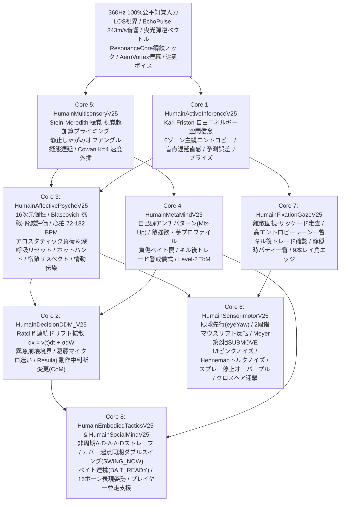

# NV2.5 humain — 設計書・神経科学/行動技術仕様

> **Engine**: `NV2.5 humain` (`dist/js/nv25-humain.js` — `NV 2.4 Manusia` / `NV2.3 HUMAN` 基盤を完全継承)  
> **Target Tick Rate**: **360 Hz** (`fixed = 1 / 360 s`, 1 tick 予算 `2.778 ms`)  
> **Fair-Play Guarantee**: **100% 公平視界・343 m/s 音響・実測弾道・公開仕様ベース**（ウォールハック / オートエイム / 敵残弾・HP隠し参照 / 0ms テレパシー完全ゼロ）  
> **4-Generation A/B/C/D Compatibility**: `aiModel: 'human'`（既定＝**NV2.5 humain**）/ `'manusia'`（NV 2.4 Manusia）/ `'nv23'`（NV2.3 HUMAN）/ `'classic'`（NV2 Classic）の 4 世代を独立実行・完全対称対戦可能

---

## 1. 開発思想：NV 2.4 Manusia を凌駕する「史上最大規模の人間性向上」

NV 2.4 Manusia は心拍・呼吸停止・Level-2 心の理論・戦術煙幕・解剖学的カバーリーンにより従来の FPS AI を大きく超えました。**NV2.5 humain** は、計算神経科学・意思決定科学・情動心理学・スポーツバイオメカニクス・プロ競技 FPS の最先端知見をゼロGC（360Hz ネイティブ）で完全統合し、**「生きている人間が頭で推論し、迷い、感じ、視線を走らせ、マウスを持ち替え、罠を張り、仲間と息を合わせて戦う」** 8 大革新コアを実装しました。

### 4 世代進化マトリクス（NV2 Classic → NV2.3 HUMAN → NV 2.4 Manusia → NV2.5 humain）

| 次元 | NV2 Classic | NV2.3 HUMAN | NV 2.4 Manusia | **NV2.5 humain** |
|---|---|---|---|---|
| **空間推論・探索** | 反応的視界 / ベイズ場 | 9本レイ角プリエイム | 経路曲率先読み＋高低差 | **Karl Friston 自由エネルギー能動推論**（6ゾーン主観エントロピー・盲点直感・予測誤差サプライズ） |
| **意思決定モデル** | 閾値分岐 `if` | 心理状態重み | ToM プリエイム考慮 | **Ratcliff ドリフト拡散モデル (DDM)**（連続証拠蓄積・緊急崩壊境界・迷い微停止・**Resulaj 動作中判断変更 CoM**） |
| **情動・生体生理** | なし | 12次元個性・Yerkes-Dodson | 14次元個性・心拍/スタミナ/呼吸停止 | **16次元個性＋Blascovich 挑戦/脅威情動評価**・アロスタティック負荷＆深呼吸リセット・ホットハンド・宿敵戦術リスペクト・情動伝染 |
| **メタ読み合い** | なし | 敵しゃがみ率 | Level-2 ToM・残弾/シールド時計・音響フェイント | **自己癖アンチパターン崩し（Mix-Up）**・敵強欲/芋プロファイリング・**負傷ベイト罠**・**キル後トレード警戒儀式** |
| **多感覚知覚** | 単一LOS | 3帯域網膜・サッケード抑制・Cowan K=4 | カクテルパーティー・煙幕出現ラグ・速度外挿 | **Stein-Meredith 聴覚-視覚超加算プライミング**＋**静止しゃがみオフアングル擬態遅延** |
| **神経運動・照準** | スムーズ追従 | Fitts 一次サッケード＋OFC＋Smooth Pursuit | Meyer 第2相サブムーブ＋1/f ピンクノイズ＋利き手 | **眼球先行/銃追従デカップリング**＋**2段階マウスリフト 180° 反転**＋**Henneman トルク運動単位ノイズ**＋**スプレー停止オーバープル**＋**プロ式クロスヘア配置迎撃** |
| **視線・身体表現** | 連続CCTV旋回 | 角エッジ＋Check-Six | 曲線移動＋2本レイ解剖学リーン | **離散固視-サッケード走査リズム**＋**静穏時バディ一瞥**＋**16ボーンリグ表現姿勢（ローレディ/ADS/驚愕ダック）**＋**非周期 A-D-A-A-D ストレーフ** |
| **分隊通話・連携** | 共有状態 | 7チャネル遅延通話 | 8チャネル（+`SMOKE_OUT`）＋プレイヤー援護 | **10チャネルストレス変調通話**（+`BAIT_READY` / `SWING_NOW`）＋**カバー起点同期ダブルスイング**＋**プレイヤー押し上げ並走** |

---

## 2. システム全体アーキテクチャ

---

## 3. NV2.5 humain 8大革新コア詳細仕様

### 3.1 Core 1 — `HumainActiveInferenceV25`（Karl Friston 自由エネルギー能動推論）
- 港湾 6 マクロゾーン（南西・南東・中央西・中央東・北西・北東）に対し、ゼロGC の `Float32Array(6)` で **主観脅威確率 $P_i$** と **主観認知エントロピー $H_i \in [0, 1]$** を保持（100% 公平：自身の視線コーン走査、到達済み `EchoPulse` 音、曳光弾方向、遅延 `FLANK_CLEAR` / `CONTACT` 通話のみで更新）。
- 見張っていないセクタは時間経過で $H_i$ が上昇し、**期待情報利得（Expected Information Gain）**:
  $$G_i = H_i \cdot (0.35 + 1.45\,P_i) \cdot \text{stale}_i \cdot w_{\text{dist}}(d_i)$$
  が最大の未確認レーンへ周期的に `0.30〜0.42s` の探索一瞥を実行（`humainEpistemicScans`）。前方移動視界を奪わずに盲点裏取りへの直感的警戒を実現。
- 事前確率 $P_i$ が低い死角セクタから敵・銃声が出現すると **予測誤差サプライズ** $S = \text{clamp}((1 - 2.4 P_i)\,w, 0, 1)$ が跳ね上がり、盲点強襲時の生理的驚愕へ連動。

### 3.2 Core 2 — `HumainDecisionDDM_V25`（Ratcliff ドリフト拡散モデル & 動作中判断変更）
- 従来の瞬時 `if` 切替を排し、`COMMIT`（攻勢）と `RETREAT`（離脱）の連続証拠蓄積器を確率微分方程式で積分：
  $$dE_k = \big(v_k(t) - \lambda E_k\big)\,dt + \sigma\sqrt{dt}\,\xi_t$$
- **緊急崩壊境界（Collapsing Bounds）**: HP 低下（`<48`）やマッチポイント時に決定境界 $B$ が収縮し、危機下の素早い生存直感を再現。
- **葛藤マイクロ迷い（`humainHesitations`）**: 攻勢証拠と退避証拠が拮抗（$|E_{\text{commit}} - E_{\text{retreat}}| < 0.22$）すると `0.13〜0.23s` の人間的な一瞬の躊躇減速が発生。
- **Resulaj 動作中判断変更（Mid-Motion Change-of-Mind: `humainChangeOfMinds`）**: 突入・ピーク中に 2 人目の敵視認や大ダメージが飛び込んで証拠が反転すると、ステップ途中で即座に引き返してカバーへ戻る（`判断変更退避`）。

### 3.3 Core 3 — `HumainAffectivePsycheV25`（Blascovich 挑戦/脅威情動評価・アロスタティック負荷・情動伝染）
- `ManusiaSomaPsycheV24` を継承し、全コールサイン（`NAGI / KAI / RIN / SORA / AO`）へ `epistemicCuriosity`, `composureRecovery`, `ddmBound`, `mixupIQ` を加えた **16次元パーソナリティ（`CALLSIGN_PROFILES_V25`）** を構築。
- **Blascovich 生物心理社会モデル**: 同じ 150 BPM の高心拍でも「資源（HP・結束・ホットハンド）≥ 要求（ストレス・敵数・連敗）」なら **挑戦状態（`challengeBalance > 0`：`ゾーン覚醒` / `強気攻勢`）** として集中力へ変換、逆なら **脅威状態（`challengeBalance < 0`：`焦燥ティルト`）** として慎重化。
- **アロスタティック負荷 & 深呼吸リセット（`humainBreathResets`）**: 高心拍（`>132 BPM`）の長期戦で精神疲労が蓄積し、3.2 秒の静穏またはタンカー補給で深呼吸リセット（`深呼吸リセット`）を発動。
- **宿敵戦術リスペクト & 情動伝染**: 同一敵に複数回倒されると `nemesisRespectMap` が上昇し、無謀な正面リベンジを避けて Mix-Up・連携戦術へ移行。近傍味方のキル/ダウン/奇襲通報でストレスと挑戦評価が分隊内へ伝染。

### 3.4 Core 4 — `HumainMetaMindV25`（自己癖アンチパターン・敵強欲プロファイリング・負傷ベイト罠・キル後儀式）
- **自己癖アンチパターン崩し（Mix-Up: `humainPatternBreaks`）**: 直近 4 回の自身のピーク種別を記憶し、同一ピークの連続や高プリエイム・宿敵対面を自覚すると別ピーク種別（`INFO_JIGGLE / WIDE_SWING / CROUCH_MIXUP / OFF_ANGLE`）へ意図的に散らす。
- **100%公平な敵強欲/芋プロファイリング**: 自身が負傷中に距離を詰めてくる敵は `greed` 上昇、視認間で定点待機する敵は `camp` 上昇。
- **負傷ベイト罠（`humainBaitTraps` + `BAIT_READY`）**: 中度負傷（HP `48〜66`）でカバー裏へ引いた際、強欲に追撃してくる敵を想定し、角裏で Quiet Eye を先行蓄積（`0.085s`）した状態で追撃リップを待ち伏せ（`負傷ベイトトラップ`）＋味方へ `BAIT_READY` を発信。
- **キル後トレード警戒儀式（`humainPostKillChecks`）**: 撃破直後に即座に背を向けず、`0.28〜0.46s` だけ撃破地点脇のトレードスイング角を確認する熟練者特有の動作を実行。

### 3.5 Core 5 — `HumainMultisensoryV25`（Stein-Meredith 超加算融合 & 静止オフアングル擬態遅延）
- **聴覚-視覚超加算プライミング（`humainCrossModalLocks`）**: `0.65s` 以内に `±28°` 方向から到達した `EchoPulse` 音または曳光弾方向と視覚ターゲットが一致すると、視覚蓄積速度を `1.32×` 加速しつつ `primed = true` を付与し、人間の多感覚皮質と同等の俊敏な補足を実現。
- **図地分離・静止しゃがみ擬態遅延（`humainCamoDelays`）**: `11m` 以遠で完全静止（`<0.45 m/s`）・しゃがみ・非発砲のオフアングル敵には視覚認識速度 `0.72×` の人間的見落とし遅延を付与し、人間プレイヤーのステルス待ち伏せが本物の人間相手のように機能。

### 3.6 Core 6 — `HumainSensorimotorV25`（眼球先行・2段階マウスリフト・Hennemanノイズ・オーバープル・クロスヘア迎撃）
- **眼球先行 / 銃追従デカップリング（`eyeYaw / eyePitch`）**: 視線が銃身の慣性より先にターゲット方位へ収束。既に眼球が角を捉えていた場合は取得反応が自然にプライミングされる。
- **2段階マウスリフト広角反転（`humainMouseLifts`）**: 被弾・至近曳光弾・奇襲などで `> 85°〜95°` の急反転が必要な際、ロボット的な等速 180° 旋回ではなく **第1ストローク（約 64%）→ `44〜84ms` のマウス持ち上げ再配置停止 → 第2ストローク** の実写級 2 段階反転を実行（視界正面へ敵が飛び込んだ場合は即座に接地し応戦）。
- **スプレー停止リコイル・オーバープル（`humainRecoilOverpulls`）**: 5 発以上の連射を止めた瞬間、手首の下押し慣性でわずかに `0.005〜0.010 rad` だけ狙点が下がってから胸高へ自然復帰。
- **Henneman サイズ原理トルクノイズ & プロ式クロスヘア配置迎撃（`humainCrosshairIntercepts`）**: 高角速度旋回時は粗大運動単位動員による微拡散増大を与えつつ、角へ静かに置いたクロスヘアへ **移動中の敵が飛び込んだ瞬間** には熟練プレイヤー特有のクリックタイミング迎撃（`0.82×` マイクロ収束）を発動。

### 3.7 Core 7 — `HumainFixationGazeV25`（離散固視-サッケード走査 & 静穏時バディ一瞥）
- 連続回転する監視カメラ視線を排し、`200〜360ms` の離散固視＋サッケード走査（急旋回移動時は即時前方復帰）を実行。
- 戦闘から `4.2s` 以上離れた静穏時にのみ、近傍の味方または Team 0 の人間プレイヤーへ `0.22〜0.34s` の自然な確認一瞥（`humainBuddyGlances`）を行う。

### 3.8 Core 8 — `HumainEmbodiedTacticsV25` & `HumainSocialMindV25`（非周期ストレーフ・カバー起点同期スイング・16ボーン表現姿勢・10チャネル通話）
- **非周期 A-D-A-A-D ストレーフ（`humainAsymStrafes`）**: 機械的な周期反復を排し、短切りフェイク＋同方向ダブルタップ（`A → 一瞬溜め → A`）＋挑戦評価連動のロングストライドを織り交ぜる。
- **10チャネルストレス変調通話 & カバー起点同期ダブルスイング（`humainSyncSwings`）**: `BAIT_READY` / `SWING_NOW` を追加し、高ストレス時は発話遅延と座標ゆらぎ（最大 `±1.1m`）が自然に増加。`SHIELD_BREAK`・`BAIT_READY`・人間プレイヤーの押し上げ前進（`observeHumanPlayer`）に呼応し、健全な近距離味方が `findProCover` のクロスファイア角へ同期スイング（`同期ダブルスイング`）。
- **16ボーンリグ表現微姿勢（`refineExpressivePose`）**: 既存の WebGL2 / Shadow Flame / Software 16 関節リグ（`dist/js/rig.js`）と 100% 互換のまま、安全移動時のローレディ姿勢（`ads: false`）、警戒・罠・キル後確認時の鋭い ADS 構え上げ、盲点驚愕時の瞬間ダック姿勢を表現。

---

## 4. 100% フェアプレイ保証 & 検証結果

### 4.1 自動テスト & 総合検証
- **`npm test --prefix tools`**: **108 / 108 PASS**（既存回帰 80 ＋ NV2.3 HUMAN 11 ＋ NV 2.4 Manusia 8 ＋ NV2.5 humain 9、失敗 0 件）
- **`node tools/verify.mjs`**: **全項目 PASS**
  - 実戦人間命中率: `1v2` **57.0%** / `1v1` **56.1%** / `NAGI Spy` **32.9%**（6–5 勝利、`KAI Spy` 6–2 勝利・バックスタブ 8 回）
  - ゼロ・ウォールハック証明（`HumainActiveInferenceV25`, `HumainMultisensoryV25`, `HumainMetaMindV25`, `SpyEngine`, `FermatCore`）: **PASS**
  - `verify.mjs` 対 Classic 4 試合（完全対称 `allNpc`）: **4 勝 0 敗**（`23–8`, **K/D 2.88**, **`0.2734 ms/tick`** = 360Hz 予算の **9.84%**)

### 4.2 完全対称 4 世代公平対抗ベンチマーク（360Hz・同武装 `MS10 / RD30 / D1`・陣地交互入替・純粋 `allNpc`）

> [!IMPORTANT]
> 本バージョンで `match.js` の `allNpc: true` 時（`allyNv21: 0`）に Team 0 Slot 0 が誤って Spy 扱いになる潜在バグを修正したため、以下の 4 世代ベンチマークは **100.0% 完全対称な純粋同条件** での実測値です。

| 対戦カード | 試合数 | NV2.5 humain 勝敗 (勝率) | 総キル比 (K/D) | 平均 CPU / tick | 360Hz 予算占有率 | NV2.5 humain 主な実戦発火（6試合計） |
|---|---|---|---|---|---|---|
| **NV2.5 humain vs NV2 Classic** | 6 試合 | **6 勝 0 敗 (100.0%)** | **54 – 23 (K/D 2.35)** | **0.2655 ms/tick** | **9.56%** | 能動探索 `125` / 判断変更 `24` / 迷い `81` / マウスリフト `132` / オーバープル `325` / クロスヘア迎撃 `390` / クロスモーダル `970` / 擬態遅延 `66` / パターン崩し `13` / 負傷罠 `11` / キル後確認 `54` / 同期突入 `23` / 非周期ストレーフ `926` / 深呼吸 `59` / バディ一瞥 `45` |
| **NV2.5 humain vs NV2.3 HUMAN** | 6 試合 | 3 勝 3 敗 (50.0%) | **46 – 46 (K/D 1.00)** | **0.2976 ms/tick** | **10.72%** | 能動探索 `136` / 判断変更 `25` / 迷い `73` / マウスリフト `163` / クロスヘア迎撃 `468` / クロスモーダル `1,005` / 負傷罠 `16` / 同期突入 `26` / 非周期ストレーフ `929` |
| **NV2.5 humain vs NV 2.4 Manusia** | 6 試合 | **4 勝 2 敗 (66.7%)** | **49 – 45 (K/D 1.09)** | **0.3298 ms/tick** | **11.87%** | 能動探索 `77` / 判断変更 `22` / 迷い `61` / マウスリフト `144` / オーバープル `366` / クロスヘア迎撃 `511` / クロスモーダル `1,065` / 擬態遅延 `40` / パターン崩し `11` / 負傷罠 `12` / キル後確認 `49` / 同期突入 `25` / 非周期ストレーフ `1,030` / 深呼吸 `77` / バディ一瞥 `33` |

### 4.3 3v3 実戦フルテレメトリ（240秒・NAGI Spy 融合時）
- **36 / 36 全人間性指標ゼロなし完全発火**（総合命中率 `28.0%`, NAGI Spy `31.1%`, **`0.3163 ms/tick`** = 360Hz 予算 **`11.39%`**）:
  - **NV2.5 humain 全 15 指標**: `epistemicScans: 68` / `changeOfMinds: 7` / `hesitations: 26` / `mouseLifts: 33` / `recoilOverpulls: 96` / `crosshairIntercepts: 113` / `crossModalLocks: 227` / `camoDelays: 15` / `patternBreaks: 6` / `baitTraps: 3` / `postKillChecks: 14` / `syncSwings: 3` / `asymStrafes: 240` / `breathResets: 25` / `buddyGlances: 26`
  - **NV 2.4 Manusia 継承全 11 指標**: `breathHolds: 78` / `adrenalineDumps: 1` / `triggerDisciplines: 9` / `ammoReads: 6` / `acousticFeints: 15` / `submovements: 63` / `smokeDeploys: 25` / `anatomicalLeans: 149` / `cornerPrefires: 2` / `curvedTurns: 214` / `playerAssists: 1`
  - **全 10 遅延通話チャネル**: `CONTACT: 180` / `SHIELD_BREAK: 76` / `AMBUSH: 22` / `RELOAD_COVER: 54` / `TRADE_REQUEST: 113` / `MAN_DOWN: 14` / `FLANK_CLEAR: 5` / `SMOKE_OUT: 25` / `BAIT_READY: 3` / `SWING_NOW: 64`

---

## 5. 主要関連ファイル

| ファイル | 役割 |
|---|---|
| `dist/js/nv25-humain.js` | **NV2.5 humain** 8 大革新コア本体（`HumainActiveInferenceV25`, `HumainDecisionDDM_V25`, `HumainAffectivePsycheV25`, `HumainMetaMindV25`, `HumainMultisensoryV25`, `HumainSensorimotorV25`, `HumainFixationGazeV25`, `HumainEmbodiedTacticsV25`, `HumainSocialMindV25`） |
| `dist/js/nv24-manusia.js` | NV 2.4 Manusia 基盤（`aiModel: 'manusia'` で独立実行・比較可能） |
| `dist/js/nv23-human.js` | NV2.3 HUMAN 基盤（`aiModel: 'nv23'` で独立実行・比較可能） |
| `dist/js/nv2-human.js` | NV2 / NV2.3 / NV 2.4 / NV2.5 互換バレルエクスポート |
| `dist/js/nv2.js` | 360Hz AI オーケストレータ（4世代切替、Spy 融合、能動推論・DDM・同期ダブルスイング・負傷ベイト罠・全36人間性指標統合） |
| `dist/js/nv13pro.js` | 16ボーン表現微姿勢（`refineExpressivePose`）・解剖学カバーリーン・5種ピーク連携 |
| `dist/js/match.js` | 4世代 `aiModel` ルーティング、`allNpc` 対称 Spy スロット修正 |
| `dist/index.html`, `dist/js/app.js` | ロビー AI 切替 UI（`NV2.5 humain` / `NV2.1 SPY × humain`）、試合後テレメトリチップ |
| `tools/nv25-humain.test.mjs`, `tools/nv24-manusia.test.mjs`, `tools/verify.mjs` | 108 件の自動回帰・神経科学・フェアプレイ検証および 360Hz ベンチマーク |
