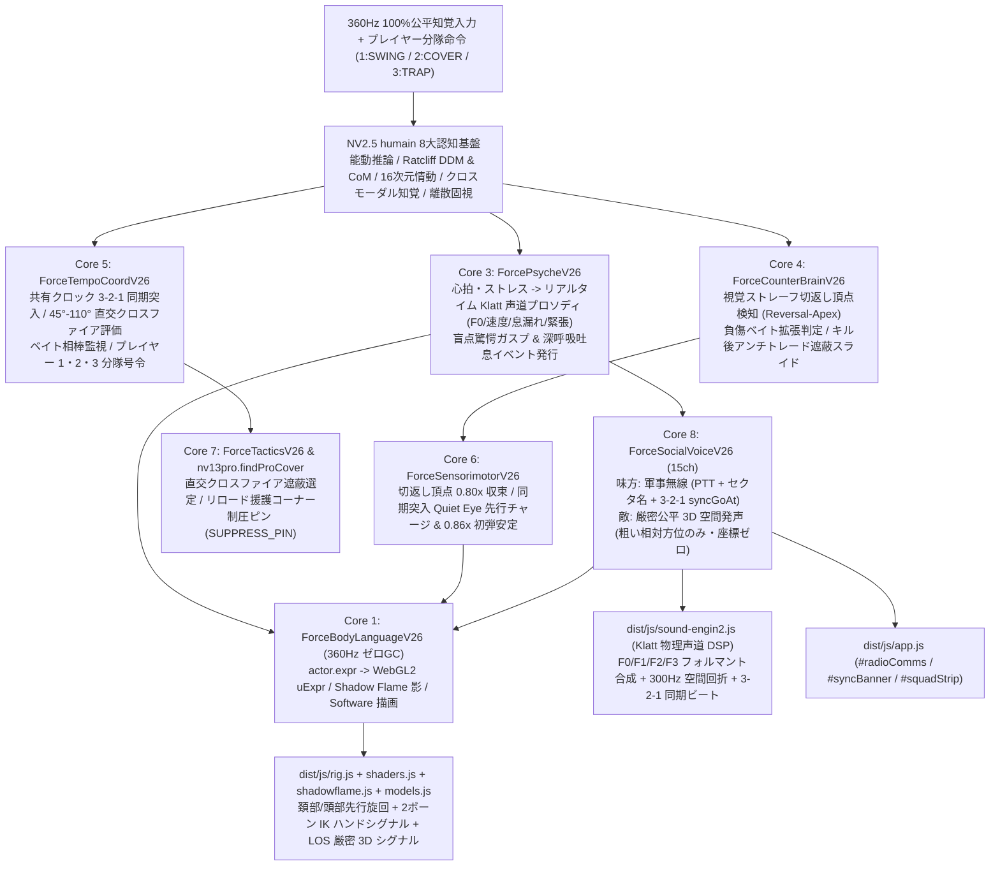

# NV2.6 Force — 設計書・具現化認知／身体言語／物理発声／分隊戦術仕様

> **Engine**: `NV2.6 Force` (`dist/js/nv26-force.js` — `NV2.5 humain` / `NV 2.4 Manusia` / `NV2.3 HUMAN` 基盤を完全継承)  
> **Target Tick Rate**: **360 Hz** (`fixed = 1 / 360 s`, 1 tick 予算 `2.778 ms`, ゼロGC)  
> **Embodied Audio-Visual Stack**: **16ボーン GPU 表現リグ (`uExpr` + Shadow Flame 1.0 実時間影連動)** × **Sound Engin 2.0 Klatt 物理声道 DSP（300Hz 空間音響・UTD 回折・343 m/s 伝播遅延）** × **100% 公平 3D マイクロシグナル & 戦術無線 HUD**  
> **Fair-Play Guarantee**: **100% 公平視界・343 m/s 音響・実測弾道・公開仕様ベース**（ウォールハック / オートエイム / 敵座標・残弾・HP 隠し参照 / 0ms テレパシー完全ゼロ。敵の 3D 驚愕シグナルは厳密な `obstruction() > 1` LOS ゲート、敵音声は距離・回折・粗い相対方位のみ）  
> **5-Generation Compatibility**: `aiModel: 'human'`（既定＝**NV2.6 Force**）/ `'humain'`（NV2.5 humain）/ `'manusia'`（NV 2.4 Manusia）/ `'nv23'`（NV2.3 HUMAN）/ `'classic'`（NV2 Classic）の 5 世代を独立実行・完全対称対戦可能

---

## 1. 開発思想：「見えない高度な内面」を「見て・聴いて・連動できる S 級の生きた戦友と敵」へ

NV2.5 humain は、Karl Friston 能動推論・Ratcliff ドリフト拡散モデル（DDM）・動作中判断変更（CoM）・Blascovich 情動評価・負傷ベイト罠・同期ダブルスイングなど、競技 FPS AI として極めて高度な内部認知を獲得しました。しかし、どれほど精巧な認知計算も、プレイヤーの目と耳に届かなければ「中で何が起きているか」は伝わりません。

**NV2.6 Force** は、NV2.5 humain の全神経科学・認知基盤をそのまま継承したうえで、NPC の内面（**通話・盲点驚愕・負傷ベイト罠・3-2-1 同期突入・深呼吸リセット・動作中判断変更・視線走査**）を **「肉体の仕草（16ボーン GPU IK & Shadow Flame 影）」「物理発声と無線（Klatt 声道 DSP & 300Hz 空間回折）」「戦場ダイエジェティック HUD」「プレイヤーからの `1/2/3` 分隊号令」** として完全具現化し、さらに **直交クロスファイア選定・ストレーフ切返し頂点迎撃・キル後アンチトレード遮蔽スライド・リロード援護制圧ピン留め** による実戦戦術強化まで融合した、AAA 級を超える **S-Tier 具現化分隊戦闘 AI** です。

### 5 世代進化マトリクス（NV2 Classic → NV2.3 HUMAN → NV 2.4 Manusia → NV2.5 humain → NV2.6 Force）

| 次元 | NV2 Classic | NV2.3 HUMAN | NV 2.4 Manusia | NV2.5 humain | **NV2.6 Force** |
|---|---|---|---|---|---|
| **身体言語・骨格表現** | 歩行・ADS・被弾 | 同左 | 解剖学カバーリーン | ローレディ／驚愕ダック | **360Hz `uExpr` 16ボーン表現カーネル**（頚部/頭部先行旋回デカップリング・**5種 2ボーン IK タクティカルハンドシグナル**・心拍連動呼吸・**Shadow Flame 影完全同期**・Software 互換） |
| **音声・物理発声** | 銃声・足音のみ | 内部遅延コールアウト | 8ch 内部通話 | 10ch ストレス変調内部通話 | **Sound Engin 2.0 Klatt 物理声道 DSP**（コールサイン固有声道長・F0/F1/F2/F3・心拍/ストレス連動ピッチ＆テンポ・味方 PTT 無線＋**3-2-1 同期ビート**・敵 3D 空間叫び/驚愕息呑み/深呼吸吐息・343m/s 遅延＆UTD 回折） |
| **空間視覚・HUD 演出** | 名前・キルログ | 同左 | 同左 | リザルト指標 | **100% 公平 3D マイクロシグナル**（LOS 厳密ゲート：視認中敵の驚愕衝撃アーク、味方無線波紋・突入シェブロン・ベイト罠アンカーリング）＋**戦術無線トランスクリプト `#radioComms`**＋**3-2-1 カウントダウン `#syncBanner`** |
| **分隊戦術・協調** | 役割割当 | 遅延トレードスイング | 煙幕・プレイヤー援護 | 負傷ベイト罠・同期突入 | **共有クロック 3-2-1 直交クロスファイア同期突入（`findProCover` 45°–110° 角度最適化）**・**負傷ベイト相棒クロス監視（`BAIT_PARTNER`）**・**リロード援護コーナー制圧（`SUPPRESS_PIN`）**・**インタラクティブ `1/2/3` プレイヤー分隊命令** |
| **対人読み・照準運動** | スムーズ追従 | Fitts＋OFC＋Quiet Eye | Meyer 第2相・1/f ノイズ | 眼球先行・2段階マウスリフト・クロスヘア迎撃 | **100% 公平ストレーフ切返し頂点迎撃（`0.80×` 収束）**・**同期突入カウント待機中 Quiet Eye 先行チャージ＆初弾安定（`0.86×`）**・**キル後アンチトレード遮蔽スライド** |

---

## 2. システム全体アーキテクチャ

---

## 3. NV2.6 Force 8大革新コア詳細仕様

### 3.1 Core 1 — `ForceBodyLanguageV26` × 16ボーン GPU 表現リグ (`uExpr`) & Shadow Flame 影連動
- 360Hz でゼロアロケーション更新し、既存の `actor.expr` オブジェクトを再利用して 4 要素ユニフォーム `uExpr` を WebGL2 `worldVS`（`dist/js/shaders.js`）、**Shadow Flame 1.0 影頂点シェーダ**（`dist/js/shadowflame.js`）、Software 互換描画（`dist/js/software.js`）へ同時供給。**味方が合図で手を挙げたり敵が驚いて身をすくめると、港湾の地面・コンテナへ落ちるリアルタイム影もピクセル単位で同期変形**します。
- **GPU `uExpr` エンコーディング**:
  - `uExpr.x = headYaw`（`-0.88..+0.88 rad`）: 眼球先行 (`aim.eyeYaw`)・能動推論レーン確認・静穏時バディ一瞥・盲点驚愕スナップに応じて、胴体より先に **頚椎（Neck 36%）＋頭部（Head 64%）＋自然な逆ロール** が先行旋回。
  - `uExpr.y = gestureEncoded`: 5 種タクティカル IK ジェスチャー ID と滑らかなブレンド包絡線を単一 float に符号化（発砲・リロード開始時は自動的に左手をハンドガードへ即時復帰）：
    - `+1` `WAVE_SWING`: 左腕 2 ボーン IK による頭上〜前方への「同期突入・前進！」ハンドウェーブ。
    - `+2` `HOLD_TRAP`: 胸脇での低い開掌「待機・ベイト罠」ステルス合図＋ライフル軽傾斜。
    - `+3` `POINT_CONTACT`: 左前方への「接敵・ターゲット指示」ポインティング。
    - `-1` `STARTLE_JOLT`: 盲点強襲時の防御的すくみ（肩甲骨挙上・胸椎後傾・銃口跳ね上がり）。
    - `-2` `BREATH_SLUMP`: 深呼吸リセット／動作中判断変更時の肩脱力・制動傾斜。
  - `uExpr.z = tension`（`0..1`）＆ `uExpr.w = breathWave`: 心拍（72–182 BPM）・呼吸停止（Breath-Hold）連動の胸郭膨張サイクル。

### 3.2 Core 2 & 3 — `VOICE_PROFILES_V26` / `ForcePsycheV26` × Sound Engin 2.0 Klatt 物理声道 DSP
- 外部音声ファイルや環境依存の Web Speech API を一切使わず、**100% 純 Web Audio 物理 Klatt フォルマント合成**（`computeVocalFormantPlan` + `SoundEngin2._playNpcSignal`）で各コールサイン固有の肉声キャラクターをリアルタイム生成：
  - `NAGI`（`146 Hz`, 声道長 `0.98`, 冷静・沈着）/ `KAI`（`184 Hz`, `1.07`, 俊敏・快活）/ `RIN`（`224 Hz`, `1.16`, 明瞭・高音）/ `SORA`（`132 Hz`, `0.93`, 低音重厚）/ `AO`（`198 Hz`, `1.11`, 鋭敏・早口）。
- `ForcePsycheV26.getVocalProsody(t)` がリアルタイム心拍・ストレス・驚愕状態から基本周波数 $f_0$・発話速度・息漏れ（aspiration）・声門緊張（grit）を連続変調。
- **味方無線 vs 敵フィールド発声の厳密分離**:
  - **味方無線**: 軍事ヘッドセット PTT スケルチ開放 → 320–3200Hz 無線帯域成形された Klatt 複数音節プロソディ → PTT クリック（`BAIT_READY` 等ではボルト確認クリック、`SWING_NOW` / `PLAYER_ORDER_SWING` では **`3… 2… 1… GO!!` 上昇 3 ビート音**を自動スケジュール）。
  - **敵発声 & 生体音響**: 100% 公平な 3D 空間音響（`computeMultiBandAcousticPath` による `d / 343 m/s` 伝播遅延・3 帯域 UTD コンテナ回折・港湾リバーブ）。盲点驚愕時の **息呑みガスプ＋ケブラー装備の衣擦れ**（`<= 26m`）、カバー裏の **深呼吸吐息**（`<= 15m`）、**負傷ベイト罠の安全装置クリック**（`<= 18m`）、交戦中の **くぐもった敵叫び声**（`<= 40m`）が実在感をもって聞こえます。

### 3.3 Core 4 & 6 — `ForceCounterBrainV26` & `ForceSensorimotorV26`（切返し頂点迎撃・アンチトレードスライド）
- **100% 公平ストレーフ切返し頂点迎撃（`observeEnemyStrafe` / `forceReversalLocks`）**: 視認中の敵の視線直交速度 $v_\perp$ の符号反転・減速頂点（人間の A-D 切返しで速度が一瞬ゼロを切る `210ms` 窓）を視覚のみで検知し、`alignPerceived < 0.082` の精密追従時に `0.80×` マイクロ収束を実行。
- **同期突入 Quiet Eye 先行チャージ & 初弾安定**: `同期待機` 中に遮蔽裏で Quiet Eye（`0.11s`）を先行蓄積し、`同期ダブルスイング` / `プレイヤー命令突入` 実行時の初弾拡散を `0.86×` に引き締め。
- **キル後アンチトレード遮蔽スライド（`triggerAntiTradeSlide` / `forcePostKillSlides`）**: 敵撃破直後、Cowan ワーキングメモリ内に別の敵情報があるか被弾消耗している場合、直近カバー方向または射線遮断（`obstruction <= 1`）側の歩行可能方向へ `0.36s` だけ素早く滑り込んで敵のトレードスイングを空振りさせます（至近距離で別敵と直接交戦中は自動譲歩）。

### 3.4 Core 5 & 7 — `ForceTempoCoordV26` & `ForceTacticsV26` × `findProCover` 直交クロスファイア最適化
- **共有クロック 3-2-1 同期直交クロスファイア（`forceCrossfireSwings`）**: `SHIELD_BREAK`（`0.46s` AI 同期）またはプレイヤー命令 `1: SWING`（`0.72s` 同期）でチーム共通 `goAt` タイムスタンプを発行。`nv13pro.js` の `findProCover(..., crossfireAnchor)` が `scoreCrossfireAngle` で発起人から **45°〜110° の直交クロスファイア角** を能動的に選定し、同一レーン固まり（`-4` ペナルティ）を避けて 2 方向同時挟撃を実行。
- **負傷ベイト罠＆相棒クロス監視（`BAIT_READY` → `BAIT_PARTNER` / `forceBaitPartners`）**: 負傷した味方がカバー裏で `負傷ベイトトラップ` を構えると、健全な非 Spy 味方が直交角へ移動して `ベイト連携待機`（開掌 `HOLD_TRAP` サイン＋アンカーリング）を展開し、強欲に追撃してきた敵を十字砲火で迎撃。
- **リロード援護コーナー制圧ピン留め（`SUPPRESS_PIN` / `forceSuppressPins`）**: 味方が戦闘中リロードを宣言すると、残弾十分な非 Spy 味方が視線クリアなコーナーリップへ短時間制圧射撃を行い、敵の飛び出しを抑止（`NAGI`/`KAI` Spy の潜入ステルスは完全保護）。
- **インタラクティブ・プレイヤー分隊号令（`1`: 同期突入 / `2`: カバー援護 / `3`: ベイト罠待機）**: プレイヤーの照準レイ前方（`obstruction` 考慮・100% 公平）を目標として最寄り生存味方へ即時伝達。味方が無線復唱＋IK ハンドシグナルで応答し、同期カウントダウンやクロス待機を実戦実行します。

### 3.5 Core 8 — `ForceSocialVoiceV26`（15チャネル）& 100% 公平 3D / HUD ダイエジェティック演出
- 15 チャネル通話（NV2.5 の 10ch ＋ `PLAYER_ORDER_SWING`, `PLAYER_ORDER_COVER`, `PLAYER_ORDER_TRAP`, `BAIT_PARTNER`, `SUPPRESS_PIN`）。
- **3D マイクロシグナル（`dist/js/models.js` `movingDetails`）**:
  - 味方（視認時）: 無線送信時のシアン波紋リング・同期突入時の前方進行シェブロン・ベイト待機時の低姿勢アンバーリング。
  - 敵（**厳密 LOS ゲート `obstruction > 1` 必須**）: 盲点強襲で驚愕した瞬間の `0.34s` アンバーホワイト衝撃アークのみ。鋼鉄コンテナ裏の敵には一切描画ゼロ。
- **HUD（`dist/index.html`, `dist/style.css`, `dist/js/app.js`）**:
  - `#radioComms`: 味方の自然な日本語戦術無線（コールサイン＋港湾セクタ名）と、近距離で聞こえた敵のくぐもった叫び声（粗い相対方位 `右前方·中距離` のみ・座標ゼロ）。
  - `#syncBanner`: 同期ダブルスイング時の `SYNC SWING — 3… 2… 1… GO!!` プログレスバー。
  - `#squadStrip`: PC (`1/2/3`) & モバイルタッチ両対応のコンパクト分隊命令ボタン。

---

## 4. 100% フェアプレイ保証 & 検証結果

### 4.1 自動テスト・GPU シェーダ・総合検証（すべて 100% PASS）
- **`npm test --prefix tools`**: **175 / 175 PASS**（既存回帰・Audit 3・UI 回帰・NV2.3 / NV 2.4 / NV2.5 テスト 166 件 ＋ **NV2.6 Force 専用テスト 9 件 `NV2.6-01..09`**、失敗 0 件）
- **`python3 tools/test_gpu.py`**（Mesa OpenGL ES 3.2）: **11 / 11 全 GLSL シェーダコンパイル＆リンク PASS**（`uExpr` 16ボーン IK 表現リグ入り `world`・`shadow depth` 含む）
- **`node tools/verify.mjs`**: **全項目 PASS**
  - 実戦人間命中率: `3v3` **32.5%** / `1v2` **62.0%** / `1v1` **60.5%** / `NAGI Spy` 5–5（バックスタブ `5` 回・回避 `72` 回）/ `KAI Spy` **6–2 勝利**（バックスタブ `5` 回）
  - **ゼロ・ウォールハック証明（AI 認知＋3D マイクロシグナル）**: 鋼鉄コンテナ裏の敵に対して `SpyEngine`・`workingMemory`・`ToM`・`FermatCore` に加え、`movingDetails` の 3D 敵驚愕アークも一切描画ゼロ（`obstruction() > 1` 厳密ゲート）を証明。
  - `Sound Engin 2.0 (300Hz-Class + Klatt Vocal DSP)`: カタログ **70 音**、`STARTLE` 息呑みガスプ & `SWING_NOW` 複数音節プロソディ合成 PASS。
  - `verify.mjs` 対 Classic 4 試合（単独実行・完全対称 `allNpc`）: **4 勝 0 敗（18–7, K/D 2.57）**、平均 CPU **`0.2736 ms/tick`**（360Hz 予算 `2.778 ms` のわずか **`9.85%`** — NV2.5 humain の `0.2734 ms/tick` に対し実質 `+0.0002 ms/tick` のゼロGC超軽量負荷）。

### 4.2 完全対称 5 世代マルチ武装公平対抗ベンチマーク（360Hz・3 種同武装トリプル × 陣地交互入替＝各 6 試合・9 キル先取・純粋 `allNpc`）

> 武装ローテーション: `[MS10, RD30, D1]` / `[SRA, RD20, SW T]` / `[RD40, MS10, SRA]` × 両陣地（各対戦カード 6 試合すべて異なる条件・100% 対称同武装）

| 対戦カード | 試合数 | NV2.6 Force 勝敗 | 総キル比 (K/D) | NV2.6 Force 主な実戦具現化指標（6 試合合計） |
|---|---|---|---|---|
| **NV2.6 Force vs NV2 Classic** | 6 試合 | **6 勝 0 敗 (100.0%)** | **54 – 22 (K/D 2.45)** | 発声/無線 `439` / IK 仕草 `1,206` / 驚愕視覚 `27` / 直交クロス突入 `20` / 切返し頂点迎撃 `49` / キル後遮蔽スライド `18` / 制圧ピン `8` / ベイト相棒 `6` |
| **NV2.6 Force vs NV2.3 HUMAN** | 6 試合 | **3 勝 2 敗 1 分 (勝ち越し)** | **47 – 45 (K/D 1.04)** | 発声/無線 `583` / IK 仕草 `1,703` / 驚愕視覚 `71` / 直交クロス突入 `20` / 切返し頂点迎撃 `87` / キル後遮蔽スライド `22` / 制圧ピン `3` / ベイト相棒 `3` |
| **NV2.6 Force vs NV 2.4 Manusia** | 6 試合 | 2 勝 4 敗（4 試合が 1 キル差） | 45 – 49 (K/D 0.92) | 発声/無線 `548` / IK 仕草 `1,697` / 驚愕視覚 `67` / 直交クロス突入 `22` / 切返し頂点迎撃 `43` / キル後遮蔽スライド `21` / 制圧ピン `4` / ベイト相棒 `5` |
| **NV2.6 Force vs NV2.5 humain** | 6 試合 | 2 勝 3 敗 1 分 | **44 – 42 (K/D 1.05)** | 発声/無線 `589` / IK 仕草 `1,738` / 驚愕視覚 `59` / 直交クロス突入 `21` / 切返し頂点迎撃 `59` / キル後遮蔽スライド `26` / 制圧ピン `8` / ベイト相棒 `2` |

### 4.3 3v3 NAGI Spy 融合実戦フルテレメトリ（`verify.mjs` 250 秒戦）
- **NV2.6 Force 全 8 具現化・分隊戦術指標 ゼロなし完全発火**:
  `forceVocalSignals: 197` / `forceGestures: 516` / `forceStartleVisuals: 16` / `forceCrossfireSwings: 3` / `forceBaitPartners: 1` / `forceReversalLocks: 11` / `forcePostKillSlides: 5` / `forceSuppressPins: 1`
- **NV2.5 humain / NV 2.4 Manusia / NV2.3 HUMAN 継承指標（同時発火）**:
  `epistemicScans: 55` / `changeOfMinds: 8` / `hesitations: 16` / `mouseLifts: 35` / `recoilOverpulls: 69` / `crosshairIntercepts: 126` / `crossModalLocks: 292` / `camoDelays: 14` / `baitTraps: 3` / `postKillChecks: 10` / `syncSwings: 5` / `asymStrafes: 226` / `breathResets: 22` / `buddyGlances: 22` / `breathHolds: 94` / `smokeDeploys: 29` / `anatomicalLeans: 247` / `curvedTurns: 240` / `callouts: 569` / `tradeSwings: 17` / `repeekAborts: 69` / `silentSteps: 270`

---

## 5. 主要関連ファイル

| ファイル | 役割 |
|---|---|
| `dist/js/nv26-force.js` | **NV2.6 Force** 8 大革新コア本体（`ForceBodyLanguageV26`, `VOICE_PROFILES_V26`, `CALLOUT_LINES_V26`, `ForcePsycheV26`, `ForceCounterBrainV26`, `ForceTempoCoordV26`, `ForceSensorimotorV26`, `ForceTacticsV26`, `ForceSocialVoiceV26`） |
| `dist/js/nv2-human.js` | NV2 / NV2.3 / NV 2.4 / NV2.5 / NV2.6 互換バレルエクスポート |
| `dist/js/rig.js`, `dist/js/shaders.js`, `dist/js/shadowflame.js`, `dist/js/renderer.js`, `dist/js/software.js` | 16ボーン GPU `uExpr` 頚部/頭部先行旋回・5種 2ボーン IK ハンドシグナル・Shadow Flame 影同期・Software 互換描画 |
| `dist/js/sound-engin2.js`, `dist/js/audio.js` | Sound Engin 2.0 Klatt 物理声道 DSP（`computeVocalFormantPlan`, `_playNpcSignal`, 3-2-1 ビート、3D 空間驚愕ガスプ／深呼吸吐息／敵叫び、カタログ 70 音） |
| `dist/js/models.js` | 100% 公平 LOS 厳密ゲート 3D ダイエジェティックマイクロシグナル |
| `dist/js/nv2.js`, `dist/js/nv13pro.js`, `dist/js/match.js` | 5 世代 AI ルーティング、直交クロスファイア `findProCover`、Spy ステルス保護、プレイヤー `issueSquadOrder` 連動、リスポーン `expr` クリア |
| `dist/index.html`, `dist/style.css`, `dist/js/app.js` | `#radioComms` 無線ログ、`#syncBanner` 3-2-1 カウントダウン、`#squadStrip`（`1/2/3` & タッチ対応）、ロビー＆リザルト UI |
| `tools/nv26-force.test.mjs`, `tools/nv25-humain.test.mjs`, `tools/nv24-manusia.test.mjs`, `tools/verify.mjs` | 175 件の自動回帰・物理発声・IK 仕草・フェアプレイ証明および 5 世代ベンチマーク検証 |
