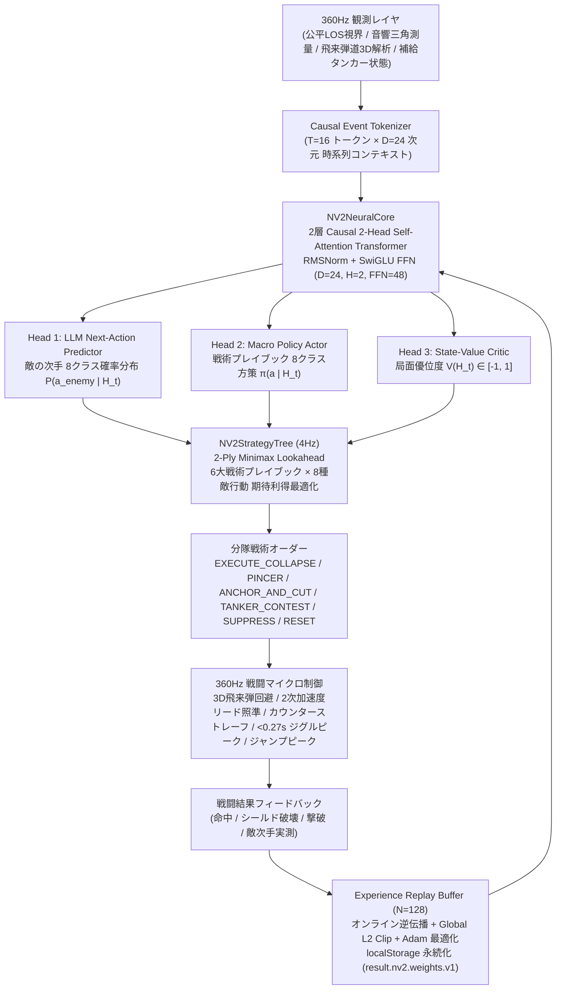

# NV2 Deep Tactical Engine — 設計書・技術仕様

> **Engine**: `NV2` (`dist/js/nv2.js`)  
> **Target Tick Rate**: **360 Hz** (`fixed = 1 / 360 s`, Unconstrained CPU Budget)  
> **Fair-Play Guarantee**: 100% 公平視界・音響・実測弾道ベース（ウォールハック / 透視 / 隠しメモリ参照ゼロ）

---

## 1. アーキテクチャ全体像

NV2 は、従来のルールベース / 有限状態機械（NV1.1 / NV1.2）および単層オンライン重み学習（NV1.3 Pro）を完全に超え、**LLM（大規模言語モデル）と同構造の因果自己注意 Transformer（Causal Self-Attention + SwiGLU FFN）** をネイティブ JavaScript（外部依存ゼロ・Float32Array 演算）でゲーム内に本格搭載した次世代タクティカル AI エンジンです。

---

## 2. NV2NeuralCore — オンライン学習 Causal Transformer

### 2.1 トークン化とコンテキストウィンドウ
試合中の戦況イベント（視認、被弾、与ダメージ、シールド破壊/撃破、敵リロード音、補給タンカー接近、プレイブック遷移）を **24次元トークンベクトル** $x_t \in \mathbb{R}^{24}$ として最大長 $T = 16$ のリングバッファへ時系列蓄積します。

| 次元 | 内容 |
|---|---|
| `0..7` | イベントチャネル One-Hot（視認 / 音響 / 与ダメ / 被弾 / 撃破・破壊 / 敵リロード / タンカー / 戦術切替） |
| `8..11` | 自隊体力比、シールド比、残弾比、精製 1.5× バフ有無 |
| `12..14` | 基準点・目標座標 $(x/24, z/96)$、交戦距離比 |
| `15..19` | 遮蔽カバー率、直近被弾量、被弾中フラグ、連続露出時間、視認敵数 |
| `20..23` | 生存人数差、タンカー稼働状態、敵リロード中フラグ、スコア差 |

### 2.2 2層 Causal Multi-Head Transformer + SwiGLU FFN
各推論ステップで、学習済み位置埋め込み $P \in \mathbb{R}^{16 \times 24}$ を加算し、2層の因果 Transformer ブロックを通過させます。

1. **RMSNorm**:
   $$\text{RMSNorm}(x) = \frac{x}{\sqrt{\frac{1}{D}\sum_{i=1}^D x_i^2 + \varepsilon}} \odot \gamma$$
2. **Causal Multi-Head Self-Attention** ($H=2, d_k=12$):
   $$\text{Attn}_h(Q, K, V)_t = \sum_{j \le t} \text{softmax}_j\!\left(\frac{q_{t,h} \cdot k_{j,h}}{\sqrt{d_k}}\right) v_{j,h}$$
   未来トークンを参照しない厳密な因果マスク ($j \le t$) により、「敵が直前に取った行動列から次の手を予測する」LLM 型系列モデリングを実現します。
3. **SwiGLU Feed-Forward Network** ($D_{\text{FFN}} = 48$):
   $$\text{SwiGLU}(z) = \big(\text{SiLU}(z W_{\text{gate}}) \odot (z W_{\text{up}})\big) W_{\text{down}}$$

### 2.3 3つの出力ヘッドと同時マルチタスク逆伝播（Adam）
最終トークンの隠れ状態 $h_T \in \mathbb{R}^{24}$ から 3 つのヘッドを出力します。

- **LLM Next-Action Predictor** ($W_{\text{pred}} \in \mathbb{R}^{24 \times 8}$):
  敵の次手 8 クラス（`PUSH_AGGRO`, `PEEK_DUEL`, `FLANK_LEFT`, `FLANK_RIGHT`, `RETREAT_COVER`, `RELOAD_WINDOW`, `TANKER_RUSH`, `AMBUSH_HOLD`）の確率分布 $P(y \mid \mathcal{H}_t)$ を予測。0.85〜3.2秒後に観測された実測行動 $y_{\text{true}}$ と照合し、クロスエントロピー勾配 $\frac{\partial \mathcal{L}_{\text{pred}}}{\partial z_{\text{pred}}} = P - \mathbf{1}_{y_{\text{true}}}$ でリアルタイム学習します。
- **Actor Policy Head** ($W_{\pi} \in \mathbb{R}^{24 \times 8}$) & **Critic Value Head** ($W_v \in \mathbb{R}^{24 \times 1}$):
  Advantage $A_t = R_t - V(\mathcal{H}_t)$ に基づく Actor-Critic 勾配＋エントロピー正則化により、勝率の高い戦術選択を強化学習します。
- **Exact Backprop & Adam**:
  出力ヘッド → SwiGLU FFN（`W_down`, `W_gate`, `W_up`）→ Layer-2 Multi-Head Attention（`W_O`, `W_Q`, `W_K`, `W_V`）まで勾配を正確に逆伝播し、Global L2 勾配クリッピング（$\|g\|_2 \le 1.0$）＋ Weight Decay 付き **Adam**（$\beta_1=0.9, \beta_2=0.999$）でオンライン更新します。学習済み重みは `localStorage`（`result.nv2.weights.v1`）へ自動保存され、試合をまたいで賢くなり続けます。

---

## 3. NV2StrategyTree — 4Hz 2-Ply Minimax 先読み戦略木

毎秒 4 回（250ms 間隔）各チームの司令塔が `NV2NeuralCore` を推論し、6 つの組織戦術プレイブックを「敵の予測次手分布 $P(a_{\text{enemy}} \mid \mathcal{H}_t)$ に対する期待利得」と「Neural Actor の優先度 $\pi(a)$」の合成スコアで評価します。

$$\text{Score}(\text{pb}) = \text{Base}(\text{pb}, s_t) + \sum_{c=0}^{7} P(c \mid \mathcal{H}_t)\,\text{Payoff}(\text{pb}, c) + 1.15\,\pi(\text{pb})$$

| プレイブック | 発動・選択される局面 | 分隊の連携行動 |
|---|---|---|
| `EXECUTE_COLLAPSE` | 敵シールド破壊・瀕死・リロード検知時 | 全員が互いに ±0.42 rad 異なるピンチ角から同期突入し確実に仕留める |
| `PINCER_DOUBLE_FLANK` | 敵が側面展開または待ち伏せ傾向のとき | ANCHOR が制圧射撃で釘付けにし、FLANKER 2名が左右挟撃 |
| `ANCHOR_AND_CUT` | 敵の左右フランク（`FLANK_LEFT` / `FLANK_RIGHT`）を高確率予測 | 予測された側面レーンの遮蔽ノードへ先回りし迎撃アンブッシュ |
| `TANKER_CONTEST` | 補給タンカー稼働中・残弾不足・敵のタンカー突撃予測時 | タンカー制圧＋弾丸 +100発・精製 1.5× バフ確保 |
| `PRESSURE_SUPPRESS` | 均衡した中距離戦・クロスファイア構築時 | 複数射線で角度を広げ、カバー裏の敵を制圧射撃で封鎖 |
| `TACTICAL_RESET` | 体力/シールド低下・人数不利時 | 脅威ヒートマップ回避経路で安全に遮蔽へ離脱・回復後に再展開 |

---

## 4. 360Hz 戦闘マイクロ技術

1. **時間正規化フィールド（360Hz 物理完全整合）**:
   影響度マップ減衰・ベイズ信念拡散を `fieldAccum >= 1/60` で時間正規化し、360Hz 駆動でも 120Hz と同一の物理速度で戦況場が進化します。
2. **360Hz リアルタイム 3D 飛来弾回避 (`dodgeIncomingShots`)**:
   30m 以内の敵飛来弾の 3D 直線軌道を毎フレーム計算し、0.26秒以内にボディカプセルへ最接近する弾道を検知すると、弾道に直交する安全側へ即時ステップ回避。さらに頭部〜胸上部の高弾道に対しては即時しゃがみダッキング（`crouchFeintUntil`）で頭上をやり過ごします。
3. **2次加速度弾道リード照準**:
   視認中の敵の速度 $\mathbf{v}$ に加え加速度 $\mathbf{a}$ を逐次推定し、$\mathbf{p}_{\text{aim}} = \mathbf{p} + \mathbf{v}\,\tau + 0.35\,\mathbf{a}\,\tau^2$ で切り返しストレーフを先読みします。
4. **カウンターストレーフ・マイクロストップ**:
   中遠距離（$>20\text{m}$）で `SW T` / `MS10` を撃つ直前に 58ms の急減速を入れ、射撃精度を大幅に引き上げます。
5. **対 `DF1 OUT` 超高速ジグルピーク（`<0.27s`）**:
   フルオート 3 発連射化された `DF1 OUT` の ARV1 焦点ロック（0.42s）を絶対に完成させないよう、露出 0.26 秒以内でカバーへ引き戻します。
6. **ジャンプピーク偵察**:
   敵の最終目撃位置が近中距離の角奥にある場合、カバー際から瞬間ジャンプピークで情報取得します。

---

## 5. 16関節フルアーティキュレーション人型モーション（`dist/js/rig.js` + `dist/js/models.js`）

NPC のキャラクターモデルと頂点シェーダを根本から刷新し、従来の簡易 5 パーツ変形から **16 ボーン階層骨格＋解析 2-Bone Arm IK＋厳密接地クランプ** へ全面アップグレードしました。

- **16 ボーン階層**: `0: Pelvis` → `1: Lumbar` → `2: Chest` → `3: Neck` → `4: Head` / `5..8: Left & Right UpperArm + Forearm (2-Bone Analytical IK)` / `9..14: Left & Right Thigh + Shin + Boot (3-Joint FK + Articulated Toe Hinge at z=-0.055)` / `15: Weapon`
- **ゼロ歪み剛体セグメント変換 (`rigOrientSegment`)**: 腕・脚の太さや装甲ボリュームを一切潰さず、法線も完全保存。
- **ミリ単位の厳密接地 (`groundFix = -min(soleL, soleR) * (1 - air)`)**: 歩行・ダッシュ・ストレーフ・しゃがみ・着地のすべてで靴底の浮き・床貫通を完全排除。
- **戦術スタッガードしゃがみ & リロード振付**: 左膝前出し・右膝落とし・重心降下によるリアルな戦闘しゃがみ姿勢、および左手による「チェストポーチ → マガジン挿入 → ボルト操作」のリロード動作を実現。
- **Shadow Flame 1.0 Flash / Pro 完全同期**: `sfShadowVS` と `worldVS` が同一の `ARTICULATED_RIG_GLSL` を共有し、走る脚・曲がる肘・リロードする腕が影にも 1 ピクセルのズレなく反映されます。

---

## 6. 360Hz 対抗ベンチマーク検証結果

公平条件（両チーム同一武装 `MS10 / SW T / SRA`、3v3・10 点先取、奇数/偶数試合で陣地完全入替、360Hz 固定刻み）での実測結果です。

| 対戦カード | 試合数 | NV2 勝敗 (勝率) | 総キル比 (K/D) | 平均 1 tick 処理時間 | NV2 オンライン学習・戦術テレメトリ |
|---|---|---|---|---|---|
| **NV2 vs NV1.3 Pro** | 8 試合 | **8 勝 0 敗 (100.0%)** | **80 – 40 (K/D 2.00)** | **0.0474 ms/tick** (21,084 ticks/s) | Adam 更新 7,402 回 / 飛来弾回避 515 回 / 同期突入 141 回 / カウンターストレーフ 401 回 |
| **NV2 vs NV1.2** | 6 試合 | **6 勝 0 敗 (100.0%)** | **60 – 15 (K/D 4.00)** | **0.0380 ms/tick** (26,285 ticks/s) | Adam 更新 4,361 回 / 飛来弾回避 528 回 / 同期突入 93 回 / カウンターストレーフ 273 回 |

- **LLM Next-Action Predictor 学習曲線（vs NV1.3 Pro, 8クラス分類・ランダム期待値 12.5%）**:
  - Match 1（初期状態）: `9.1%` (3/33) → Match 2: `30.0%` (6/20) → Match 3: **`46.7%`** (7/15) → Match 4–5: **`37.5% – 40.0%`**（ランダムの 3.0〜3.7 倍の的中率へオンライン収束）。
- **360Hz 余裕度**: 360Hz の 1 ティック予算 `2.778 ms` に対し、3v3 フル稼働＋Transformer 推論/学習込みで **`0.047 ms/tick`**（予算比 1.7%、リアルタイムの 58 倍速）で動作します。
