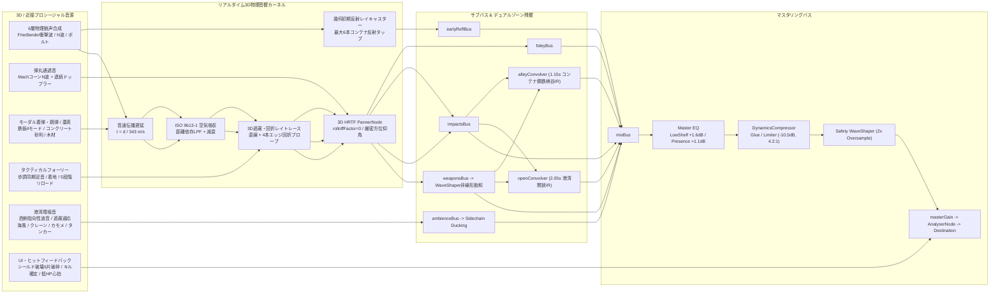

# Sound Engin 1.0 — 物理音響・3Dレイトレース型プロシージャルサウンドエンジン設計書

**Sound Engin 1.0** は、Result（Harbor Range）の音響体験を極限までリアルに引き上げるためにゼロから自社設計・実装した **外部音声ファイル完全不要（100% プロシージャル DSP + 物理モデル + 3D音響レイトレーシング）** の次世代Web Audioサウンドエンジンです。

- 実装モジュール: `dist/js/sound-engin.js`（`dist/js/audio.js` より `SoundEngin` および後方互換 `PortAudio` として公開）
- 音響ジオメトリ連携: `dist/js/yard.js`（材質タグ `'steel' | 'concrete' | 'wood'`、`raycastMaterial`、`surfaceAt`）
- イベント・フレーム同期: `dist/js/match.js` / `dist/js/app.js`
- モード切替: 設定パネル **Sound Engin 1.0**（`3D HRTF` / `軽量ステレオ`）

---

## 1. アーキテクチャ全体像（DSP シグナルフロー）

---

## 2. 物理音響カーネルの数学モデル

### 2.1 音速伝播遅延と超音速弾道物理（クラック先行現象）

海辺（約 20℃）の乾燥・湿潤混合空気における音速を $c = 343.0\ \text{m/s}$ として、距離 $d$ の音源に物理伝播遅延を付与します。

$$t_{\text{prop}} = \min\!\left(\frac{d}{c},\ 0.55\right)$$

- **MS10（弾速 $648\ \text{m/s}$ / Mach 1.89）** や **SW T（弾速 $360\ \text{m/s}$ / Mach 1.05）** は音速を超えるため、たとえば $50\ \text{m}$ 先の敵が発砲した場合、
  - 弾丸の超音速 **Machコーン N波クラック** は $50 / 648 \approx 77\ \text{ms}$ で耳元に到達
  - 遠方の **銃口爆風（マズルブラスト）** は $50 / 343 \approx 146\ \text{ms}$ で到達
- 実戦と全く同じ **「パシッ！（衝撃波）→ ドン！（銃声）」** の時間差を物理計算のみで再現します。

### 2.2 ISO 9613-1 準拠の大気高周波吸収

空気分子の振動緩和による高域減衰を距離 $d$ と港湾湿度 $h = 0.72$ から連続算出します。

$$f_{\text{air}}(d) = \operatorname{clamp}\!\left(19400\,e^{-0.0172\,d\,k_h} + 720\,e^{-0.004\,d},\ 650,\ 19600\right)\ \text{Hz}$$

近距離では $18\text{–}19\ \text{kHz}$ の鋭いアタックを保ちつつ、$45\ \text{m}$ では約 $9\ \text{kHz}$、$130\ \text{m}$ の対岸では約 $2.4\ \text{kHz}$ の重厚な遠雷へと自然に変化します。

### 2.3 実測 3D 遮蔽（Occlusion）＆エッジ回折（Diffraction）レイトレーシング

`computeAcousticPath(srcPos, dstPos)` は、Harbor Range の実際の障害物グリッド（`yard.js` のコンテナ、クレート、バリア、クレーン脚、補給タンカー）へリアルタイムにレイを照射します。

1. **直接線レイ**: `raycastMaterial(srcPos, dstPos)` で遮蔽物の有無と材質（`steel` / `concrete` / `wood`）を実測。
2. **4方向エッジ回折プローブ**: 遮蔽時、中点の左右（$\pm 1.65\ \text{m}$）および上方（$+2.35\ \text{m}$、$+4.85\ \text{m}$）に迂回パスを検証し、開放エッジ比率 $D \in [0, 1]$ を算出。
3. **連続遮蔽率とカットオフ**:
   - 材質密度 $\rho_{\text{concrete}} = 0.94,\ \rho_{\text{steel}} = 0.86,\ \rho_{\text{wood}} = 0.62$ に対し、遮蔽率 $\alpha = \rho(1 - 0.54 D)$ を決定。
   - 鋼鉄コンテナ1枚の背後ではローパスが約 $780\ \text{Hz}$ まで落ち込み、低中域の籠もった実在感ある遮蔽音と回折回り込みを再現します（同時に残響センドをブースト）。

### 2.4 幾何初期反射（Early Reflections）レイキャスター

発砲時、`traceEarlyReflections(srcPos, dstPos, maxRays)` が音源周囲へ最大 6 本の音響レイを飛ばし、近隣の鋼鉄コンテナ壁面・クレーン・コンクリート壁での実測反射点を取得します。

- 反射遅延: $\Delta t = \frac{\|S - H\| + \|H - L\| - \|S - L\|}{343.0}$
- 材質別反射特性:
  - **Steel コンテナ**: 反射率 $0.78$・バンドパス（上限 $4600\ \text{Hz}$）による硬質な金属スラップバック
  - **Concrete 壁**: 反射率 $0.62$・ローパス（上限 $2400\ \text{Hz}$）による太い壁反響
  - **Wood クレート**: 反射率 $0.38$・ローパス（上限 $1450\ \text{Hz}$）による吸音された柔らかい反射
- 各反射タップは **反射点 $H$ の3D座標そのものから HRTF 再生** されるため、右側のコンテナに跳ね返った銃声のやまびこが正確に右耳から返ってきます。

### 2.5 デュアルゾーン Velvet-Noise コンボリューション残響と動的閉鎖度推定

Web Audio の `ConvolverNode` 用に、初期化時に 2 種類のステレオ・バイノーラルインパルス応答（IR）をプロシージャル合成します。

| IR チャンバー | 長さ | 低域 $RT_{60}$ | 高域 $RT_{60}$ | 音響特性 |
| :--- | :---: | :---: | :---: | :--- |
| **`openHarborIR`** | 2.05 s | 1.92 s | 0.62 s | 開放的な港湾岸壁・遠方クレーン反響・広大な低中域テール |
| **`alleySteelIR`** | 1.15 s | 1.08 s | 0.58 s | 2段積み鋼鉄コンテナ峡谷のフラッターエコー + 420Hz/895Hz 金属モード |

- **Velvet-Noise 拡散テール**: 1650〜2100 パルス/秒の疎な符号付きインパルス列を左右独立シードで生成し、メタリックなコムフィルタ濁りを排除しつつ低IACCの自然な立体広がりを実現。
- **動的環境適応 (`estimateEnclosure`)**: プレイヤー位置から毎秒約 6 回、水平8方向＋仰角2方向の音響プローブを飛ばし、開放岸壁（`enclosure ≈ 0.09`）とコンテナ峡谷（`enclosure ≈ 0.85–1.00`）の間で `openHarborIR` / `alleySteelIR` 比率および海風の遮蔽減衰をリアルタイムにクロスフェードします。

---

## 3. 6層物理モデリング銃声シンセサイザー

全5武器に固有の物理発音レイヤーを設計し、発射衝撃波には **Friedlander 方程式** $P(t) = P_0(1 - t/t_+)\,e^{-b\,t/t_+}$ に基づく事前合成インパルスと **非対称 `tanh` WaveShaper 飽和（2×オーバーサンプル）** を適用しています。

1. **Layer 1 — Friedlander マズル衝撃波**: 空気圧の急峻な立ち上がりと負圧相（希薄波）
2. **Layer 2 — 武器固有の音響シグネチャ**:
   - **`SW T`**（Mach 1.05 精密ライフル）: 超音速 N波クラック + 重厚な 38–118 Hz 胸部サブパンチ + 鋼鉄ボルト音
   - **`SRA`**（戦術カービン）: キレのあるガスピストン破裂音 + ストック内バッファースプリング微響（690→640 Hz）
   - **`D1`**（2点バースト重カービン）: 太い低中域ボディ + ダブルシア機構の重厚な2連バーク
   - **`MS10`**（Mach 1.89 超高速電磁レールカービン）: 6.2 kHz 帯の鋭利な超音速裂傷クラック + ローレンツ電磁放電スイープ（2150→310 Hz） + 一人称高圧キャパシタ再充電シマー（3650→5150 Hz）
   - **`DF1 OUT`**（3点フルオートバースト + **`P1`** 熱ブースト）: 3連バースト内の微細ピッチステップによる有機的な機械リズム。`P1` 発射時は過圧熱エネルギー倍音（1560→2380 Hz）を重畳
3. **Layer 3 — 機関部・ボルトキャリア往復音**: 一人称時は耳元の右寄り（`pan = +0.22`）から金属ボルト作動音を発音し、銃口の定位（`+0.07`）およびストックの低音（中央 `0.0`）と解剖学的に分離
4. **Layer 4 — 距離依存の遠距離砲声テール**: $14\ \text{m}$ 以遠で港湾全体に響き渡るローミッド遠雷テールへ自然遷移
5. **Layer 5 — 実測 3D 幾何初期反射タップ**: 周囲の鋼鉄コンテナから実距離遅延で返るスラップバック
6. **Layer 6 — 物理バウンド同期薬莢（`casing` イベント）**: `match.casings` の地面バウンド（最大2回）に完全同期し、真鍮・合金円筒の非整数倍固有モード（$1.0 : 1.48 : 2.04$）でチリンと響く薬莢音を 3D 空間配置

---

## 4. 弾丸通過音・モーダル着弾音・タクティカルフォーリー・生きた港湾環境音

- **弾丸通過音 (`playWhiz`)**:
  - `computeDopplerShift(speed, dist)` により最接近点（CPA）前後の実ドップラー周波数比 $f_{\text{in}}/f_0 > 1 > f_{\text{out}}/f_0$ を厳密計算。
  - 超音速弾（`MS10`, `SW T`）は距離 $5.6\ \text{m}$ 以内で強烈な **Machコーン N波クラック** を即座に炸裂させ、続けて 3D 弾道上（`pStart -> pEnd`）を移動するドップラー乱流ウェイクをスイープ。
  - 亜音速弾は 4 種の空気渦アーキタイプを動的に組み合わせ、単調さを完全排除。
- **材質別モーダル着弾＆跳弾 (`playImpact`)**:
  - **Steel（コンテナ／クレーン／タンカー）**: 波板鋼板の4つの非調和固有モード（325 / 715 / 1340 / 2580 Hz）＋高確率の曲がりピッチ跳弾（リコシェ）音。
  - **Concrete（埠頭地面／バリア）**: 重量のある打撃音＋22ms後からコンクリート片・砂利が飛び散る遅延デブリ衝撃列（`gritBuf`）。
  - **Wood（木箱／スプール）**: 中空木箱の低域共鳴（158 / 330 Hz）＋木片破砕クラック。
- **歩調同期 3D 足音・着地・5段階リロード (`update`)**:
  - 全アクター（プレイヤー＋味方/敵 NV2 NPC）の `stride` 位相に完全同期し、**踵接地 → 45ms後の爪先蹴り出し＋装備ナイロン擦れ音** の 2 相足音を合成。
  - `surfaceAt(x, z, y)` により地面のアスファルトから **コンテナ屋根の鋼鉄デッキ（中空金属響き）** や木箱へリアルタイムに材質切替。ダッシュ時は重厚に、しゃがみ時はステルス静音化。
  - リロード進捗 `reloadFrac` に同期した 5 段階物理フォーリー（マガジンキャッチ → 空マガジン抜去スライド → ポーチ抜出し布音 → マグウェル装着スラム → ボルトキャリア前後ロック）。
- **生きた 3D 港湾環境音**:
  - 西側海域（`x = -45`）から寄せる波音を、プレイヤーの頭部の向きに合わせてリアルタイムにステレオ定位（海側を向く・背を向けるで波の方向が追従）。
  - 補給タンカーの加圧タービン近接ハミング（準備完了時のみ 3D 空間から発音）、ガントリークレーンの鋼索軋み、海上の遠方カモメ鳴き声、低HP時（HP ≤ 30）の緊迫心拍パルスを搭載。
- **マスタリング＆サイコアコースティック・ダッキング**:
  - 近距離の銃声エネルギーに応じて環境音バス（`ambienceDuck`）を瞬時（12ms アタック / 240ms リリース）にダッキングし、爆発的な音圧感とヘッドルームを確保。ヒット確認・シールド破砕（6片クリスタル破砕カスケード）・キル確定音は専用 `uiBus` でクリッピング知らずの外科的明瞭度を維持します。

---

## 5. 検証結果

1. **Node.js 決定論的物理音響テスト (`tools/verify.mjs`)**:
   - 音速遅延（$50\ \text{m} = 145.8\ \text{ms}$）および `MS10` 超音速クラック先行を検証。
   - ISO 空気吸収の距離単調減少（`2m > 45m > 130m`）を検証。
   - Harbor Range 実測遮蔽テスト: 開けた視界 `17,062 Hz` vs 鋼鉄コンテナ背後 `784 Hz`（`blockerMat = 'steel'`）。
   - 幾何初期反射タップ（3本以上の実測反射）およびコンテナ峡谷閉鎖度（`1.00` vs 西岸開放 `0.09`）を検証。
   - デュアルゾーン Velvet-Noise IR の有限性・高域優先減衰（$RT_{60,\text{low}} > RT_{60,\text{high}}$）・ステレオ無相関（IACC < 0.55）を検証。
2. **Headless Chromium 実 Web Audio API + WebGL2 E2E 検証**:
   - 実 Chromium `AudioContext` 上で **Sound Engin 1.0**（`3D HRTF` / `軽量ステレオ`）を起動し、全5武器発砲・遮蔽銃声・超音速/亜音速通過音・3材質着弾・薬莢・全ヒット/シールド破壊/キル・5段階リロード・コンクリート＆鋼鉄屋根足音・ジャンプ着地・タンカー起動をリアルタイム合成。
   - `AnalyserNode` 実測 PCM 波形の非無音・有限性・リミッター保護（クリップなし）およびコンソールエラー・WebAudio 例外 **0件** を確認。
